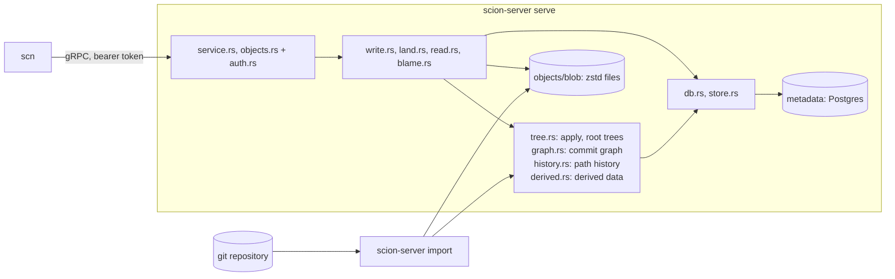
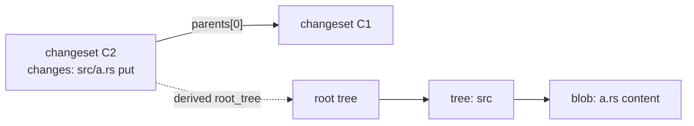
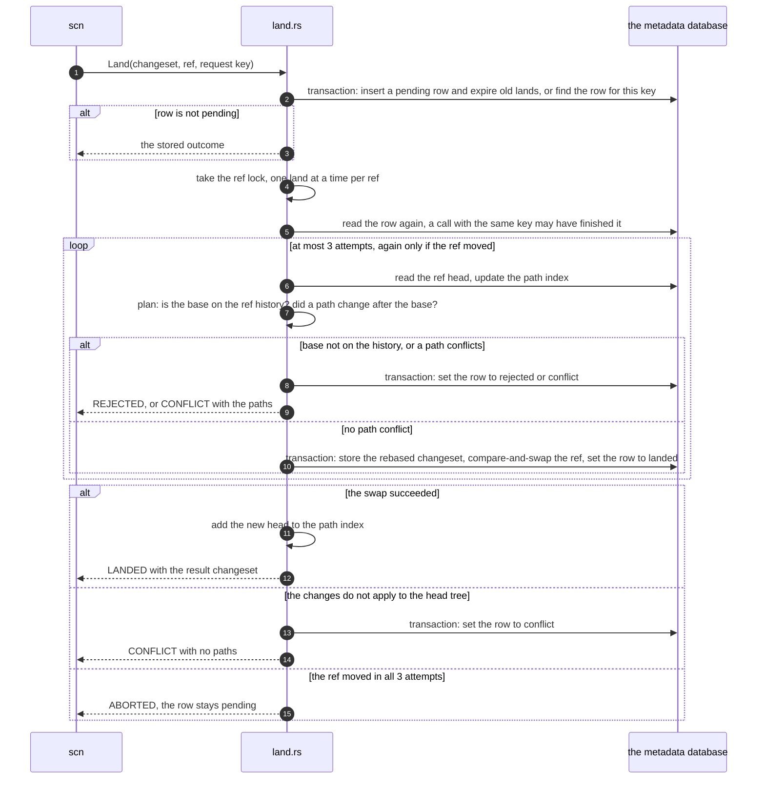
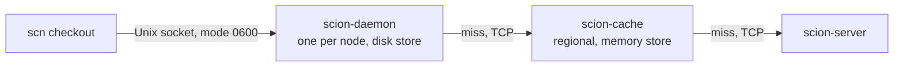

# Architecture

This document explains how openscion works, for a new contributor who has
read the [README](../README.md). It describes the code on `main`. Parts that do
not exist yet are marked **planned**, with the issue that tracks them.
The design follows Anthropic's article
[Redesigning source control](https://www.anthropic.com/engineering/redesigning-source-control).
The README lists where this project makes its own choices.
The metadata may live in Postgres instead of the data directory (#178,
part 2 of [#47](https://github.com/bnsd55/openscion/issues/47)); a
backend that scales out to *many servers* on one database is still a
proposal ([`design/scalable-backend.md`](design/scalable-backend.md)).

## 1. Overview

| Crate | Role |
|---|---|
| [`scion-core`](../crates/scion-core) | Object model (`Changeset`, `Tree`, IDs, `RepoPath`) and the v1 encoder and strict decoder. No I/O. |
| [`scion-proto`](../crates/scion-proto) | gRPC types generated from [`proto/scion.proto`](../proto/scion.proto): the `Scion` and `Objects` services, whose contract is [`protocol-v1.md`](protocol-v1.md). Largest message 64 MiB, stream chunk 1 MiB; a `GetObjects` reply message holds one part of an object, at most 1 MiB plus its header. Also the code that the server and the tiers share: the bearer-token check (`auth.rs`), how an object travels in parts and encodings (`object.rs`), and the `GetObjects` reply rules (`reply.rs`). |
| [`scion-server`](../crates/scion-server) | One binary: `serve` (the API), `import` (git import), `fsck`, `gc`, `derive`, `hash-token`, `ticket-key`. |
| [`scion-tier`](../crates/scion-tier) | The cache tiers (section 7): a `Tier` library and two binaries, `scion-cache` (memory) and `scion-daemon` (disk, Unix socket). |
| [`scn`](../crates/scn) | Command-line client: `cat`, `ls`, `log`, `blame`, `show`, `merge-base`, `is-ancestor`, `diff`, `checkout`, `commit`, `land`, `bench`. |



How one request flows through the server:

1. The server serves at most 128 connections at once (`--max-connections`).
   A client beyond that waits, unread, until a connection closes, and the
   process logs a warning. One connection has at most 256 calls open at
   once (`--max-streams`, HTTP/2 `SETTINGS_MAX_CONCURRENT_STREAMS`). Every
   connection closes in time, so a waiting one gets a place:
   - A client that sends no HTTP/2 preface within 20 s of getting its
     place is closed. hyper has no timeout there, and its keepalive starts
     only after the preface.
   - After the preface: after 60 s without a frame from a client, the
     server sends an HTTP/2 ping, and closes the connection if no answer
     comes within 20 s.
   - After 30 min, the server asks a connection to close (`GOAWAY`). The
     client connects again for new calls. The calls in it get 10 min more
     (at least the 600 s of the longest call), and then the connection is
     closed. So a connection beyond the cap waits at most 40 min for
     another to close.

   Each TCP connection has Nagle's algorithm off, so a small reply does not
   wait for the client's ACK. The tiers share this code
   (`scion-proto/src/listen.rs`) and its defaults. Size `--max-connections`
   for the clients that keep a connection: on a cache, at least the daemons
   behind it plus room for others; on the server, at least the caches plus
   the direct clients.
2. The bearer-token check (`scion-proto/src/auth.rs`) tags the request with
   a `Caller`.
3. `service.rs` (the `Scion` service) or `objects.rs` (the `Objects` service)
   checks names, IDs and paths, then runs `write.rs`, `land.rs`, `read.rs`
   or `blame.rs` on a blocking thread (the database and the blob folder are
   synchronous). Both services share one bound: at most 256 run at once,
   and at most 4 of them are `Blame` calls. A
   request times out after 600 s; for a streamed reply that covers only its
   start. A `GetObjects` or `ReadFile` reply ends when its client takes no
   part for 120 s.
   A timeout, or a client that cancels,
   drops the call but not a job that is already running. So a land checks
   a deadline in its long loops (the index advance and the walks back to a
   base): 600 s after the call started, or as soon as a guard that the call
   holds has dropped. Then the land stops and stays pending, and the client
   sees `CANCELLED` or `DEADLINE_EXCEEDED`.
4. `error.rs` maps errors to gRPC codes. Database, I/O, git and corruption
   errors reply `INTERNAL`. The detail goes only to the server log.
5. Each call runs in one tracing span that the server opens: the RPC and
   the peer at the start, and the principal and the repo once the call
   knows them (`caller()` records the principal, the access checks record
   the repo). The refusals log one `WARN` line at the decision: a wrong
   token, a repo that the caller may not read (the reply still says that
   it does not exist), or a path or repo that it may not change. A
   malformed request or a missing object logs nothing at `WARN`. A failure
   keeps its detail in the log, inside the span, so that line carries the
   RPC, the principal and the repo too. A reply that runs past its call
   takes the span with it. A line never carries the token, not even its
   digest. The store and its index sit below the repos, so their lines
   name no repo.

## 2. Object model

Three kinds of objects. All are content-addressed and never change.

| Object | What it is |
|---|---|
| Blob | The raw bytes of one file, or the target of one symlink. |
| Tree | One directory level: entries sorted by raw name bytes, each a file state or a child tree. |
| Changeset | One commit: parents, author, optional committer, message, and the changed paths. |

**A changeset stores only first-parent deltas.** `parents[0]` is the diff
base. `changes` maps each path that differs from `parents[0]` to a new file
state or to a delete. Other parents, such as the second parent of a merge, are
recorded but not diffed. So a changeset's size grows with the change, not
with the repository. The full snapshot is derived data (section 4).

A file state is a regular file (blob and executable flag), a symlink (blob
that holds the target), or a gitlink (a git commit ID, no blob). Only git
import sets `committer`, creates a changeset with zero or several parents, or
creates a repo or a ref. No RPC creates a repo or a ref, so a new repo starts
with `scion-server import`.



**IDs.** Every ID is BLAKE3 over a domain prefix plus the object's canonical
bytes. Each kind has its own prefix (`scion\0blob\0v1\0`,
`scion\0changeset\0v1\0`, `scion\0tree\0v1\0`), so the same bytes get a
different ID as each kind. `BlobId`, `TreeId` and `ChangesetId` are distinct
Rust types. A blob ID hashes the uncompressed file bytes.

**Generation** is graph metadata, stored next to the changeset and not part of
the hash: 1 for a root, else 1 + the highest parent generation.

**Why the format is frozen.** An ID is a hash of the bytes, so any change to
the encoding changes every ID. The decoder accepts exactly one encoding per
object, so an accepted object re-encodes to the same bytes and the same ID.
Golden tests, property tests and a fuzz target pin this. A change needs a new
format version. [`format-v1.md`](format-v1.md) has the bytes, the path rules
and the decoder rules.

## 3. Storage

The metadata lives in a Postgres database, at the schema the server's
URL names (same tables, one server per database; the schema is checked
against these tables by a test), and its rules are in the operations
guide ([`operations.md`](operations.md), "The metadata in Postgres").
The blob files stay in the data directory:

```text
<data>/lock                    shared by every process that uses <data>
<data>/open.lock               held while a process opens <data>
<data>/server.lock             held by the one server process
<data>/backend                 the marker that binds the directory to its database
<data>/objects/blob/ab/cd..    one zstd file per blob, named by its ID in hex
<data>/tmp/                    staging for atomic blob writes and uploads
```

**Checking a data directory.** `scion-server --data <dir> fsck` reports the
damage it finds, and changes nothing: it reads, and leaves every repair
to you. It checks every blob file against its ID, every blob that a row
names, every changeset, tree and history node against its ID, every ref
and derived row against the changesets it names, and every derived
value with its kind's decoder. It reads in short batches, so it can run
while the server runs; each check looks at the state at the moment it
looks, so a clean report means "no damage seen", not a snapshot. One
line per problem: kind, ID, path. Exit 0 when it saw no damage, 1 when
it did, 2 when it could not run. Rows of a derived version this build
does not know are reported as `derived-old`, and are not damage: the
steps of the kind remove them (section 4).

**Tables** ([`migrations/`](../crates/scion-server/migrations)):

| Table | Holds |
|---|---|
| `repos` | Repository name to `repo_id`. |
| `changesets` | ID, generation and `ChangesetV1` bytes. Global: one row per changeset, whatever repos have it. |
| `changeset_parents` | Parent `n` of each changeset, also indexed by parent. |
| `repo_changesets` | Which changesets a repo may read. Every changeset read checks this table. |
| `repo_blobs` | Which blobs a repo may name: those uploaded to it, and those that its changesets name. `CreateChangeset` checks this table. A row goes only when `scion-server gc` collects it: a blob past the grace period that no stored changeset of the repo puts. A row is not a promise that the blob is stored. |
| `refs` | Ref name to target and `version`. A ref moves only by compare-and-swap on `version`. A foreign key keeps the target in the repo. |
| `lands` | One row per land request, unique on (repo, caller, request key): state, result, detail, conflict paths, and when it finished. A finished row expires after 7 days (section 5). |
| `trees` | `TreeV1` bytes by tree ID. Global. |
| `history_nodes` | Nodes of path history trees by the hash of their bytes. Global. Rebuildable (section 4). |
| `derived` | Derived values by (kind, version, changeset), as bytes that each kind encodes. Rebuildable (section 4). |
| `git_import` | Git commit ID to changeset, per repo, so a re-import skips known commits. |

Trees live in the database, not in the blob folder, so a derivation that
writes many trees commits them in one transaction. When a database opens,
each migration in `migrations/` that is newer than its version runs, in
order, in its own transaction. A released migration never changes. A build
refuses a database with a newer version. Version 3 lets a derived value have any length; the
upgrade copies every row. Version 4 adds `repo_blobs`. SQL cannot read the
blob IDs inside changeset bytes, so the upgrade runs a step in Rust
(`db::fill_repo_blobs`) in the same transaction: it reads each changeset of
each repo once and adds the blobs that its changes put. A changeset lists
every path that differs from its first parent, so these are every blob that
the repo's trees name. It logs its progress every 10,000 changesets. It is
one transaction, not resumable: a crash rolls it back, and the next open runs
it again from its start. A blob uploaded before the upgrade and named by no
changeset must be uploaded again. Version 5 adds `history_nodes`.

**Connections.** Each process has one write connection behind a mutex, and
8 read-only connections (`store::READERS`). Write transactions use
`BEGIN IMMEDIATE`. The migrations run on the write connection before the
read connections open. In WAL mode a read connection reads beside a write, so a
read never waits for a write, and a long read never makes a write wait.
`Store::read` takes an idle read connection, or waits for one. It runs
outside any explicit transaction, so each statement sees its own snapshot:
every commit that it can see when it starts. A caller that needs one
consistent view reads it in one statement. (A snapshot held across the
statements of back-to-back reads would keep the auto-checkpoint from ever
copying the whole log, so the log would never restart and its file would
grow.) `Store::read_unflushed` runs
on the write connection. Writes use it to read what they are about to
change, under the same lock. The read connections close first, so the write
connection closes last and moves the log into `scion.db`.

**Blob folder.** One zstd file per blob, at most 100 MiB uncompressed. A write
goes to a temp file in `tmp/`, is flushed, and is renamed into place. The zstd
frame header holds the uncompressed size, so `Blobs::size` reads only the
header. A read unpacks the file and checks its hash. A check that does not
need the content (`Blobs::verify`, used by puts, `CreateChangeset` and
import) streams the file through the decoder into the hasher, so it holds the
zstd window and small buffers, not the whole blob. A file that does not match
its ID, or that unpacks to more than 100 MiB, is corrupt, and the next put of
that content replaces it.

**Uploads.** `PutBlob` streams (`Blobs::upload`). Each message goes into the
hasher and to a spool file in `tmp/` before the server reads the next one, so
an upload holds one message in memory, not the whole blob. The spool file
holds raw bytes, because the frame header needs the size before the first
compressed byte. After the last message, the server keeps an intact stored
copy only if the repo of the upload has the blob already (`repo_blobs`).
Otherwise it streams the spool file through the compressor into the temp
file, and renames it over any stored copy. So an upload of content that only
another repo has takes the same write path as one of new content: its time
does not show that the content exists. Then it adds the blob to the repo. The spool file has no name, so a dropped
upload or a crash leaves nothing behind. Each process stages its temp files
in its own folder of `tmp/`, held with a lock, and an open removes the
folders of processes that no longer hold theirs (see below).

**One writer per blob.** The final step of a blob write is a rename onto the
blob's path, and two writers of the same content rename onto the same path.
Within a process, every write of a blob takes the stripe of its ID's first
byte (256 stripes, one per byte value), so two writes of one blob run one
after the other, and no rename of a write races the rename of another. The
lock is per process: an import shares the data directory with a server, and
its writes go through their own stripes. `fsync_dir` covers the rename's
directory entry.

**Durability rules.** A metadata commit is durable when the transaction
returns: every connection runs `synchronous_commit = on`, and the server
refuses to open a database that turned it off. So a reply that names a
commit — a ref target from `ResolveRef`, a land state from `GetLand`, a
tree ID from a derivation — names a commit the database will not lose,
and the database's own durability rules carry it from there.

- A read that derives a value, such as the root tree for `GetRootTree`,
  commits the derivation before it replies (section 4). So a client never
  gets a tree ID that a power loss can undo.
- A blob is durable after `BlobBatch::sync`: a plain `fsync` of each blob
  file when written, then of each changed fan-out directory, then a full
  flush of the drive (`F_FULLFSYNC` on macOS, where a plain `fsync` can
  leave the bytes in the drive's cache).
- No committed metadata may name a blob that a crash could lose. `PutBlob`
  syncs its blob before it replies. `CreateChangeset` reads back, hashes and
  syncs every blob it names before its transaction. Git import syncs one blob
  batch per 1,000 commits before the transaction that records them.
- A stored blob still costs a full flush when it is put again or named by a
  changeset: another batch may have written it and not synced yet.

Unit tests check where each flush comes. No test cuts the power: the crash
suite kills the process, and the kernel keeps what it wrote (section 10).

**Processes that share a data directory.** One `serve` runs per database —
a second fails at open — and an `import` runs beside it: the import takes
no one-server lock, it writes through its own database session and stages
its blob files in the same directory. Each process holds its `flock`s on
the directory until the last `Store` clone is dropped:

| Lock file | Held by |
|---|---|
| `<data>/server.lock` | The server, exclusive. Lands are serialized in its memory (section 5), so a second server is refused. `derive` opens as the server too: it removes rows of older versions of a kind, which a running server of an older build may still read. |
| `<data>/lock` | Every process, shared, for its whole life. An open first tries to take it exclusive, to learn whether another process uses the directory. An older build holds it exclusive for its whole life, so it and this build keep each other out. The file holds the build of the processes that use the directory (below). |
| `<data>/open.lock` | A process while it opens the directory, so opens take turns. |

- **Alone at open.** A process that opens the directory alone also removes
  files in `tmp/` of a build older than the folders, and runs schema
  migrations. Every open, alone or not, removes the folders of `tmp/` that
  no process holds: each process stages its temp files in its own folder,
  which it holds with a `flock` for as long as it lives, so the temp files
  of a crashed import are removed by the next open, of any process
  ([#101](https://github.com/bnsd55/openscion/issues/101)).
  A shared open of an older schema fails: stop the other processes to
  upgrade it.
- **One build.** Each process removes the derived rows of older versions of
  a kind (section 4), which a process of an older build may still read. So
  the first process writes its build into `<data>/lock`: the schema version
  and the version of each kind (`store::build`). An open while other
  processes run fails unless its build is the same.
- **Writes take turns.** Each write transaction holds the database's rows
  it touches; a write that waits for another writer's lock gives up after
  5 s and fails with `UNAVAILABLE`, so the client retries. An import ends a
  write transaction after 1 s, so a server write waits for at most that
  plus one commit
  ([#100](https://github.com/bnsd55/openscion/issues/100)). While a server
  write waits, it holds the server's write connection, so the server's
  other writes wait too. Its reads do not: they use the read connections.
- **Refs.** Both processes move a ref by compare-and-swap on its `version`,
  each in a write transaction. The server sees a move that the import made at
  its next land on the ref: each plan reads the head from the database and
  advances the path index to it (section 5).
- **Blobs.** The import syncs each blob batch before the transaction that
  names its blobs, as the server does. So a blob that the server reaches
  through metadata is durable. The server reads blob files directly, and
  checks each against its ID.

## 4. Derived data

Derived data is computed from changesets and is not part of them.

**What the article says.** Everything that is not part of a changeset is
derived data, and one generic mechanism computes all of it. Each kind is
defined recursively: its value for a changeset is computed from its values
for that changeset's parents. For each kind, the server chooses to compute it
eagerly or to defer the work. Clients never see these structures, so the
server can change them without a client change.

**How this project does it** (`derived.rs`). Only two ideas in this table
come from the article: a value comes from the parents' values, and a kind is
computed eagerly or on demand. The rest is this project's choice.

| Part | Here |
|---|---|
| A kind | `derived::Kind`: a name, a version, and `derive`, a function from a changeset and its parents' values, in parent order, to a value. Each kind encodes its value as bytes. |
| Inputs | By default the first parent's value only, and only first-parent history is derived: a changeset stores only its changes against its first parent (section 2), so a kind over snapshots needs no more. A kind with `ALL_PARENTS`, such as `commit_graph` (below), gets the value of every parent, and every ancestor is derived. `derive` may also read the stored value of an older changeset that it reaches through those parents. |
| On demand | `derived::get_by` reads the stored value; if there is none, it derives it in steps (`fill`, below) under the caller's deadline. The doors without a request of their own (`fsck`, the import, background work) use `derived::get_unbounded`, which never fails for time. |
| Steps | `fill` walks from the changeset through the parents that the kind reads, and stops at each changeset with a stored value. It visits at most `derived::STEP` (100) changesets per hold of the write connection. It keeps the changesets without a value, 40 bytes each with the generation, so it visits each one once. A walk over every parent also keeps the set of changesets it visited. Then it derives them in generation order, oldest first, at most `STEP` changesets per transaction, and commits each one. A parent's generation is below its child's, so each changeset comes after its parents. Other writes run between steps. A step reads a value that is already stored, for example by a concurrent `fill`, and does not derive it again. So a changeset has a value only if each parent that its kind reads has one, back to the roots. |
| Eager | A kind can also store its value when the changeset is written. `root_tree` does (below). `commit_graph` does if each parent has a value, and `path_history` if the first parent has one (`derived::on_write`), so a write never derives a long history. |
| Storage | One `derived` row per (kind, version, changeset), written in the transaction that derives it. A large structure belongs in its own table, and the value is its ID, as `root_tree` keeps trees in `trees`. |
| A version bump | A new version reads and writes only its own rows. So the old rows become unused, and nothing rewrites them. The new version derives its values again, in steps. Each step, and each write of a root tree, also deletes up to `STEP` rows of older versions of its kind, as each new land deletes a few expired lands. Rows of a newer version stay: a newer build that ran on this data may run again, and it reads them. Rows of a kind that the build no longer has also stay. |
| Backfill | `derived::backfill`, and `scion-server derive --kind root_tree --ref main` (with the server stopped: it opens the data directory as the server), fill a ref's history in steps (its first-parent history for `root_tree` and `path_history`, every ancestor for `commit_graph`), then delete every row of an older version, `STEP` rows per transaction. It is safe to repeat. |
| Repos | Rows are keyed by changeset alone. A changeset ID fixes its whole history, so a value is the same in every repo. `get`, `fill` and `derive` check `repo_changesets` first, so a stored value never leaks to a repo that cannot see the changeset. |
| Durability | A value can name rows that its derivation wrote, such as trees, and a reply can send it to a client. So when `get` derives a value, it waits for one full flush after the last step, shared with concurrent commits, before it returns. It waits on an error too. `fill`, `derive` and `put` never flush: inside a write, the write's own flush covers them. |
| Crashes | Each step commits on its own, and values never change. So a crash or an error between steps leaves only correct rows. The next read walks back to the stored values and goes on from there. |
| One answer | A second write of a value must equal the first, or the store reports corruption. |

**Cost of a new kind or version.** The first read of a tip with a long
history derives the whole history under its call's 600 s deadline. A cold
history that takes longer fails the call with `DEADLINE_EXCEEDED`, and
because each step commits, the next call goes on from the stored steps.
Other requests wait for at most one step at a time. A backfill before the
server starts removes the wait.

**Root trees.** Kind `root_tree` version 1 (`tree::RootTree`): the root tree
of a changeset's full snapshot, as a 32-byte tree ID. It is the first
parent's root tree plus the changeset's changes. It is eager.
`tree::store_changeset`, the one write path for changesets (`CreateChangeset`,
`Land`, git import), does this in the caller's transaction: apply the
changes, store the new trees, insert the changeset, record its `root_tree`.
If the row is missing, `tree::root_tree` derives it on demand. A golden test
pins the tree IDs of a fixed history, both when they are stored at write time
and when they are derived on demand.

The write needs the first parent's root tree in its transaction. After a
version bump of `root_tree`, that parent has no row, and the transaction
would derive its whole history. So `CreateChangeset` and `Land` call
`tree::fill_root_tree` on the parent before the transaction, and the
transaction then finds the parent's row. Git import does the same for each
first parent from before its batch: a server that shares the data directory
waits for the batch's transaction (section 3).

`tree::apply` runs all deletes before all puts, so one changeset can turn a
file into a directory or back. It loads only the directories on changed paths
and removes directories left empty. It fails on a delete of a missing path or
of a directory, and on a put where a file or a directory is in the way.

**Views.** A partial reader reads through a view the server derives from its
read prefixes (`views.rs`). The derivation is a pure function of the rule set
and the real trees, so its results are a rebuildable cache: one `view_trees`
row per (repo, rule-set digest, projection version, real tree, path-context
digest), in the same shape on both backends. A derivation asks the table at every directory, so a new changeset
re-derives only the folders on its changed paths; the rest of the view comes
from the rows, and the changeset's root row is the row of its real root tree
under the rule set's full context. Each derivation's write also sweeps at
most `VIEW_EXPIRE_STEP` (256) dead rows: rows of an older projection version
first, then rows of a digest that no read rule of the repo hashes to any
more. `scion_view_trees_walked_total` counts the real trees a derivation
opened; a count that stays high on every changeset of one rule set says the
memo is not serving and every derivation re-walks.

**Commit graph.** Kind `commit_graph` version 1 (`graph::CommitGraph`). The
article says that Scion keeps skip lists for the commit graph as derived
data. The form of the skip list here is this project's choice: the
skew-binary jump pointers of Myers ("An applicative random-access stack",
1983). Each changeset gets a node of 112 bytes, or 160 with a merge:

- its generation, and its first-parent depth (0 for a root),
- its first parent, and one jump to an older changeset on its first-parent
  history. If the parent's jump and the jump after it span the same depth,
  the jump goes over both, else to the parent. So the depth that a jump
  lands on depends only on the depth it starts from,
- the newest changeset with two or more parents on its first-parent history,
  itself included.

Each link holds the changeset ID, its generation and its depth, so a walk
decides where to go before it reads the next node. A walk down a
first-parent history to a generation or a depth takes the jump unless the
jump goes past the target, and reads O(log n) nodes (Myers). So does the
search for where two first-parent histories meet: from the same depth, the
two jumps land on the same depth, and they land on two changesets exactly
while that depth is above the meeting point. The kind reads every parent, so
each ancestor of a changeset with a node has one, and the queries can follow
any parent (section 7). The node is stored when a changeset is written, if
each parent has one. In a database from before the commit graph, the first
query derives it in steps.

**Path history.** Kind `path_history` version 2 (`history::PathHistory`).
The article says that Scion builds dedicated structures for file blame and
path history from the changesets, through the same mechanism. The form here
is this project's choice. The value of a changeset is the root of its
history tree. A history tree has the shape of a directory tree, but it holds
every path that a changeset on the first-parent history put or deleted. Each
entry holds:

- the newest changeset, at or below this one, that changed the path or a
  path below it, with its generation,
- the generation of the newest one that put or deleted a file at the path
  itself,
- the node of the paths below it, if any changed.

A changeset's tree is its first parent's tree, with the entries of its
changed paths, and of the directories above them, set to the changeset. So
a changeset stores the nodes of the directories on its changed paths, as
for its root tree, and shares the other nodes with its first parent. A
node is one directory level, stored in `history_nodes` by the hash of its
bytes. A level above 64 KiB is cut into chunks at content-defined
boundaries (`history::Cut`): the mean chunk holds 128 entries, and a chunk
that reaches 64 KiB is cut anyway. So a change in a directory of 100,000
names stores about 47 KiB of new rows, not the 6.3 MB node of every name
the directory ever had, and a change rewrites only the chunks its names
land in. As with trees, no node is ever deleted for a draft that never
lands, or for a changeset that a land stored again on a new head — but a
version bump may drop the old-format rows, as migration 0007 did for
trees, and the new version derives them again. The value is stored when a
changeset is written, if its first parent has one.
In a database from before path history, the first query that needs it
derives it in steps. A golden test pins the root nodes of a fixed history.

A deleted path keeps its entry, so a land on a base from before the delete
still sees the change. The cost: the rows of a level hold every name that
its directory ever had on the first-parent history, and no row is ever
deleted ([#114](https://github.com/bnsd55/openscion/issues/114)). A
change rewrites only the chunks its names land in, but the chunks it
touches are rewritten whole, while a tree holds only the live names. A
directory that churns through new names spreads its level over more
chunks, and each later write in it reads and writes more of them.

`Log` with a path and blame (section 7) and the land check of an old base
(section 5) read it. A unit test of
`derived.rs` shows that a kind with another value type, which is derived only
on demand, works the same way.

## 5. The write path

An agent writes in three steps. Only the last one moves a ref.

1. `PutBlob` for each new file, in 1 MiB chunks. Returns the blob ID.
2. `CreateChangeset` with `ChangesetV1` bytes. Returns the changeset ID.
3. `Land` rebases the changeset onto a ref and moves the ref.

All three are safe to repeat. A land retry must reuse its request key.
`GetLand(land_id)` returns the stored state of a land that the same caller
started.

**CreateChangeset** (`write.rs`):

1. Decode strictly, with at most 100,000 changes. A larger change count is
   refused before any change is read.
2. Check the request: exactly one parent, no committer, a message of at most
   1 MiB, author name and email of at most 1 KiB each.
3. In one read: check that the repo exists and has the parent, and that the
   repo has each blob that a regular file or a symlink puts (`repo_blobs`).
   A gitlink names no blob, whatever its bytes. So a bad request reads no
   blob. A blob of another repo gets the error of content that no repo
   stored, before any file is read, so neither the answer nor its time shows
   that another repo has it. The error names the first such path, in path
   order. The check holds at step 5: the changeset's transaction re-adds
   the row of each blob it puts, and gc removes only rows past the grace
   period that no stored changeset names (`gc.rs`).
4. Read back each blob it names, before the write transaction. A blob that many
   paths name is read once. The error names the first path, in path order,
   whose blob is missing or corrupt.
5. In one write transaction: check the repo and the parent again. If the repo
   already has this ID, return it (a retry). Then `tree::store_changeset`.
   Changes that do not apply to the parent's tree are `INVALID_ARGUMENT`.

**Blobs per repo.** The blob files are shared by all repos: one file per
content. But a repo may name only its own blobs: those uploaded to it, and
those that its changesets name. `tree::store_changeset`, the one write path
for changesets (commits, lands and imports), adds each blob that a changeset
names to its repo. So a blob that a changeset of a repo names always belongs
to that repo, and a changeset cannot name another repo's blob and then read
it with `ReadFile`. A rename needs no new upload: the repo has the blob. Two
repos that share content each have their own row. A blob uploaded to a repo
but not yet named belongs to that repo, whoever uploaded it. `GetObjects`
still reads any tree or blob by ID
([#13](https://github.com/bnsd55/openscion/issues/13), section 7).

**Land** (`land.rs`):



- **Retries by request key.** The caller chooses the key, unique per
  (repo, caller). A retry with the same key finds the same row: a finished
  land returns its outcome, a pending one resumes. The same key with a
  different changeset or ref is `INVALID_ARGUMENT`. `scn land` uses
  `<changeset ID>:<ref>` as the default key.
- **Retention.** A finished land (landed, conflict or rejected) is kept for
  7 days after it finished (`LAND_RETENTION_SECS`). A pending land is kept
  until a retry finishes it. Each new land deletes up to 100 expired lands,
  oldest first, in the transaction that records it. The newest land always
  stays, so a land ID is never given out twice. The upgrade to schema
  version 2 gives older finished lands the time of the upgrade, so their
  7 days start then.
- **A retry after expiry** is a new land with a new ID, and `GetLand` with
  the old ID returns `NOT_FOUND`. It cannot land the changeset twice: the
  landed copy changed every path of the changeset after its base, so the new
  land is a conflict. The exception is a changeset with no changes: it lands
  again as one more empty changeset, and no file changes.
- **The rebase** is the input changeset with its parent replaced by the ref
  head. Changes, author and message stay the same. If the base is already the
  head, the result is the input changeset itself.
- **Crash safety.** The pending row commits before any other work. One
  transaction then stores the rebased changeset and its root tree, moves the
  ref, and marks the row landed. A crash leaves a pending row (a retry
  finishes it) or a landed row (a retry returns it), never a moved ref
  without a landed row. The ref lock is one mutex per (repo, ref), in process.
- **Durable before the reply.** Every reply waits for a full flush that covers
  the land's transactions (`Store::flush`). The land releases the ref lock
  first, so the lands queued behind it share that flush.
- **ABORTED on contention.** Only git import moves a ref without the ref lock,
  in the server's process or in an import process beside it (section 3). It
  moves the ref once, at its end, by compare-and-swap. If the land's
  compare-and-swap fails, the transaction rolls back and the land is planned
  again from the new head. After 3 attempts the call fails with `ABORTED` and
  the row stays pending. The caller retries with the same key. `scn land`
  does not retry. Run it again: the default key is the same.
- **Outcomes.** `CONFLICT` and `REJECTED` are land states in a successful
  reply, not gRPC errors. A land to a missing ref is rejected at once. If the
  path check passes but the changes do not apply to the head tree, the land
  is a conflict with no paths.

**The path index.** Each ref slot holds an in-memory `PathIndex` over the
ref's first-parent history, from a `floor` changeset to the `tip`:

- `files`: path to the newest generation that put or deleted it,
- `dirs`: directory to the newest generation that changed anything below it.

It is built on the first land to a ref, and again after the size budget
dropped it. It grows forward when the ref moves, and backward when a land
has an older base, down to `MAX_DEPTH` (one cycle, 10,000) generations below
the tip. If the head does not descend from the tip, it starts over. After an
error other than `ABORTED` or `DEADLINE_EXCEEDED` it is dropped and rebuilt,
because it may be ahead of the database. A deadline leaves it whole: an
advance adds nothing until it reaches the tip, and a `reach` adds one
changeset at a time, so a retry goes on from there.

A changed path `p` conflicts when one of these is newer than the base:
`files[p]` (the same path changed), `dirs[p]` (something below `p` changed),
or `files[d]` for a directory `d` above `p` (a file at a parent path changed).

**Why `generation > base_gen` means "changed after the base".** A child's
generation is at least 1 + its first parent's. So generations strictly
increase along a first-parent chain. The index holds only changesets on the
ref's first-parent chain, and a land is rejected unless its base is on that
chain. On such a chain, a changeset comes after the base exactly when its
generation is greater than the base's. So a path changed after the base
exactly when its newest generation in the index is greater than `base_gen`.
The check costs one lookup per path part, not a walk over history. A merge's
changes are its diff against its first parent, so paths that a merge brought
in are indexed at the merge's generation.

```text
gen        10        11          12          13
main:      B ─────── X ───────── Y ───────── H   (head)
                     puts a.rs   puts b/c.rs

land of a.rs, base B   files["a.rs"] = 11 > 10    conflict
land of b,    base B   dirs["b"]     = 12 > 10    conflict
land of d.rs, base B   no entry                   lands on H
```

**Pruning.** The index works in cycles of 10,000 generations of the tip.
During a cycle it notes the oldest base that a land used. When the cycle
ends, the floor moves up to that base, or to the tip at the cycle start if no
base was older. Every entry at or below the new floor is dropped. So memory
follows the oldest base in use, not the time since the server started. A
base that a cycle used stays in the index until the next cycle ends.

A base more than `MAX_DEPTH` generations below the tip is not added to the
index and does not count as used. So however old the bases are, they keep
at most about three cycles of history in the index. Such a base is rare: a
client lands soon after it reads the head.

**Size budget.** Pruning bounds the generations, not the paths: one cycle of
changesets with many paths each could fill memory. So the indexes of all refs
share one budget of 128 MiB (`MAX_INDEX_BYTES`), about 1M entries of short
paths. An entry costs its path plus 64 bytes. One atomic counter in `Lands`
holds the sum of all indexes. An index gives its bytes back when it is
pruned, starts over or is dropped. Every addition takes its exact cost from
the counter before it is made (`Lands::reserve`): the keys that the index does
not hold yet, each once (`PathIndex::cost`).

- If too few bytes are free, the indexes of other refs are dropped, least
  recently landed on first, until the addition fits. An index whose ref lock
  is held is in use, so it stays. If dropping all the others that are not in
  use would not free enough, none is dropped. A dropped index gives its bytes
  back at once, and a land frees its memory after it releases the database
  lock and the ref lock. It is built again at the head on the next land to
  its ref. A concurrent land can take the freed room first, so a reservation
  drops indexes at most twice.
- The least-recently-used list holds only the refs that have an index or
  that a land uses. A reservation that drops indexes first removes the
  others, so it looks only at refs with an index.
- If the addition still does not fit, an advance or a land moves the floor
  up to the tip: the index starts over, empty, at the head. So does an
  advance of more than `MAX_DEPTH` changesets, so it never holds the
  write connection for a long walk.
- A `reach` back to an older base stops at the first changeset that does not
  fit. That changeset is the floor, and the walk below checks the rest.

So all indexes together never hold more than the budget, however many refs
take lands. The index of a ref that no longer takes lands goes when another
ref needs the room.

**Why pruning cannot hide a conflict.** After a prune, the index still holds,
for each path, the newest generation that changed it after the floor. A
land's base is at or above the floor, or below it:

- At or above the floor: every dropped entry has a generation at or below the
  floor, so at or below `base_gen`. It never counts as newer than the base,
  so the check gives the same answer as before the prune.
- Below the floor, at most `MAX_DEPTH` below the tip: `reach` walks the
  history in the database from the floor back to the base, and adds each
  changeset it passes. The index then holds every change after the base
  again. If the budget stops `reach` first, the land is checked as in the
  next case.
- Below the floor and deeper: the land is checked in the path history of the
  head (section 4), and the index does not grow. The commit graph says
  whether the base is on the head's first-parent history: a walk down that
  history to the base's generation reads O(log n) nodes. Then a lookup of
  each path of the land reads one node per path part. Its entries give the
  newest generations that changed the path, a path below it, and a file at
  each directory above it. So a path conflicts exactly when the index rule
  says so, over the whole history. The check reads O(path parts x paths)
  rows, however old the base is, and its memory follows the size of the
  land.

A dropped index, or one that started over, is an index whose floor is the
head, so a land on an older base is the second or third case. So the choice
of the new floor, of `MAX_DEPTH` and of the budget changes only the speed,
never the answer, and no base is too old to check. A property test checks,
on random histories with merges, deletes and paths that are files and then
directories, that the path history, an index over the changesets after the
base, and a walk back to the base give the same paths for every base.

If the head has no path history yet, in a database from before it, the land
releases the ref lock. It derives the head's node in the commit graph and its
path history in steps, takes the lock again and plans again. Other writes,
and lands on the ref, run between the steps. The derivation stops between
steps at the land's deadline, and the land stays pending; the steps before
it stay. If the head still has no path history after that, the land fails
with `INTERNAL`.

**Not planned now:** a lander that rebases a batch of pending lands and moves
the ref once ([#18](https://github.com/bnsd55/openscion/issues/18), closed: one
machine already gives about 200 durable lands/s). The
[scalable backend design](design/scalable-backend.md) says when it would be
needed: many servers on one database, which the Postgres backend does not
give yet (one server runs per database).

## 6. Git import

`scion-server --data DIR import [--repo main] [--rev HEAD] [--ref main] [--verify 100] GIT_DIR`
imports one way, from a local git repository. It can run while the server
runs (section 3). Only SHA-1 repositories are supported.

**Mapping.**

- Each git commit becomes one changeset. Its parents are the changesets of the
  git parents, in git order. Its changes are the git tree diff against the
  first parent. Subtrees with the same git ID on both sides are skipped.
- Author and committer are kept. The `encoding`, `gpgsig` and `mergetag`
  headers are dropped. Changeset IDs are not git commit IDs.
- Modes `100644`/`100664`, `100755`, `120000` and `160000` become regular,
  executable, symlink and gitlink entries. Any other mode, a path that breaks
  the path rules, or a file over 100 MiB fails the import.

**Order and batches.**

1. Walk every commit reachable from `--rev`, parents first, with an explicit
   stack. Commits already in `git_import` are not imported again.
2. For each batch of 1,000 commits, build the changesets, write new blobs into
   one blob batch, and sync it.
3. Derive the missing root tree of each first parent from before the batch,
   in steps, as after a version bump. Then store each changeset with
   `tree::store_changeset`
   (with its root tree, and its commit-graph node if each parent has one),
   record its `git_import` row, and verify the sampled commits. The stores
   of a batch run in transactions that end after 1 s, so a server that
   shares the directory waits for that plus one commit, and not for the
   batch; the import stays off the write lock 100 ms between two
   transactions. A failed check rolls back the chunk of its transaction.
   Earlier commits stay, so a rerun continues.
4. Point the ref at the tip. The checks in the table below run in reads,
   and the move is a compare-and-swap on the ref's `version`. If a land moved
   the ref in between, the import checks it again.

**Verification.** Every new root and merge commit is checked, plus `--verify`
other new commits, evenly spaced and ending at the newest. A check compares
the Scion root tree with the git tree, entry by entry: names, kinds,
executable flags and content hashes. It also checks that each blob file is
stored intact.

**Forward-only refs.**

| The ref today | Result |
|---|---|
| does not exist | created at the tip |
| is the tip, or already contains it (lands made after an earlier import) | left alone |
| is an ancestor of the tip | moved forward to the tip |
| anything else (diverged) | the import fails, the ref is left alone, the commits stay imported |

## 7. The read path

Every read except `ResolveRef` names an immutable object (a changeset, tree
or blob ID), never a ref, so any cache tier can answer it. A client resolves
a ref first. `scn` accepts a ref name or a 64-digit changeset ID wherever it
takes a revision, and resolves refs through `Objects`.

**Path reads (`Scion` service).**

| RPC | Answer |
|---|---|
| `ResolveRef` | The changeset a ref points at. The only mutable answer. |
| `GetChangeset` | `ChangesetV1` bytes. |
| `ReadFile` | A regular file's content, or a symlink's target, in 1 MiB chunks. |
| `ListDir` | One directory level as `TreeV1` bytes. |
| `Log` | First-parent history, newest first. With a path, only the changesets that change it, however far apart. A reply streams in parts of up to 1 MiB of encoded entries, like `ReadFile`'s chunks; a part holds at most one page of 1,000 entries, and the last part's `next_changeset_id` says where to continue. `scn log` asks again until it has `-n` entries. |
| `Blame` | For each range of lines in a file, the changeset that last changed it on first-parent history, across renames, and that changeset's author, time and path of the file. A reply streams in parts of up to 1 MiB of encoded ranges, like `Log`'s; the last part's `next_cursor` says where to continue. |
| `MergeBase` | The best common ancestors of two changesets, over all parents. |
| `IsAncestor` | Whether one changeset is an ancestor of another, over all parents. |
| `Diff` | The paths whose file differs between two changesets' snapshots, with the old and new file state, and renames as `git diff` finds them. At most 1,000 paths per reply. `next_after` says where to continue. |

**Path history** (`Log` with a path, `read::log_page`). It returns, newest
first, each changeset on the first-parent history of the given changeset
that changes the path: the file itself, or anything below it if it is a
directory. It reads the path history (section 4). The path's entry in the
given changeset's history tree names the newest such changeset, and its
entry in the tree of that changeset's first parent names the one before it.
So each entry reads one changeset and the node rows of each path part,
however many changesets lie between two entries. A level above 64 KiB is
cut into chunks (section 4), but a name can land anywhere in its level, so
a file in a directory that churns through names reads more rows per entry
([#114](https://github.com/bnsd55/openscion/issues/114)). So a call stops
once it has read 64 MiB of nodes (`read::MAX_LOG_NODE_BYTES`), after its
first entry, and `next_changeset_id` says where to continue. A call
keeps the nodes it read, so it reads each node once. A `Log` with a path
runs as a graph query (below): at most 4 at once, each until its 600 s
deadline. On a database from before path history, its first call derives
the path history in steps, and stops between steps at the deadline. A
commit on a merged branch never
appears; the merge appears when its diff against its first parent changes
the path. The article stores changes against the first parent because people
care about history and blame only for commits on the main line.

**Blame** (`blame.rs`). The article does not describe how blame is
computed. These steps, the diff and the bounds below are this project's
choices. For a file at a changeset:

1. Read the file. A directory, a symlink, or a submodule is
   `INVALID_ARGUMENT`. A file whose bytes do not fit the shared blame
   memory budget (below) is `RESOURCE_EXHAUSTED`. A binary file is blamed
   line by line, as `git blame` does: git decides that a file is binary
   only to show diffs, and `git blame` diffs it as text all the same.
2. Walk first parents to the next changeset C that changes the path. The
   older version is the file at the path in C's first parent. If no file is
   there (nothing, or a directory), it is the file that C renamed to the path,
   if any (below). Diff the older version with C's version, line by line. The
   lines that C added go to C. The other lines move to their place in the
   older version, at its path.
3. Repeat from C's first parent until every line has a changeset. If there
   is no older version, or its bytes do not fit the budget left, every line
   left goes to C. So a file deleted and added again starts over, as in
   git.

**Renames.** Blame follows a rename, as `git blame` does by default. Where C
adds the path, the source is one of the files that C deletes. `Blame` and
`Diff` find renames with one implementation (`similar.rs`), git's rules from
`diffcore-rename.c`. Blame gives it one added file:

1. A file with the same blob ID. This reads no file. On a tie, a file with
   the same name (the last part of the path) wins, then the first by path,
   among the first 100.
2. Else, if exactly one deleted file has the same name: that file, if it is
   at least 75% similar.
3. Else, if C deletes at most 1,000,000 files (git's limit of pairs): the
   most similar file, if it is at least 50% similar. On a tie, a file with
   the same name wins, then the first by path. The search looks at every
   deleted file, over several calls if it must (below).

Similarity is git's. Each file is cut into chunks that end after a newline or
after 64 bytes. In text (no NUL byte in the first 8,000 bytes, git's test for
binary), a CR before a newline does not count. Each chunk goes to one of
107,927 buckets with git's hash, so two different chunks can count as the
same, as in git, and a file's table has at most that many rows. Similarity
is the bytes of the chunks that both files have, over the size of the larger
file. A file less than half the size of the other is not read. A symlink or
a submodule that becomes a regular file is a type change, not a rename, as
in git. Each changeset that a range names comes with the path of the file
there. `Log` with a path does not follow renames, as `git log` without
`--follow`.

Where rename following differs from `git blame`:

- A deleted file over a limit of step 1 is never similar here
  ([#90](https://github.com/bnsd55/openscion/issues/90)).
- git also treats a file as binary, so a CR counts, when `.gitattributes`
  marks it `binary` or `-diff`. Here only the NUL byte test counts.
- git keeps the four best similar files while it compares, and on a tie the
  one it keeps first can be a later file. So on a tie among more than four
  files it can pick another one.
- Neither finds copies or moved lines by default (`git blame -C`, `-M`).
  Here there is no option for them.

The diff is Myers with an indent heuristic, from `gix` (`gix::diff::blob`),
already a dependency for the import. `git blame` also uses Myers by default.
Where several minimal diffs exist, for example around repeated lines, the
two can place a line differently, so the blame can differ from git there.
Tests compare the result with `git blame --first-parent`, line by line, on
histories where they agree: edits, merges, a file that becomes a directory
and a file again, and renames for each rule above.

**Bounds and resume.** A `Blame` call walks versions through the path
history: the versions come from `history::newest_change`, so a call reads
one changeset and a few node rows per version, however many changesets lie
between two versions, and holds those node bytes of its memory share. It
also diffs
at most 100 versions, and about 1M lines (`MAX_BLAME_DIFF_LINES`, both
sides of each diff, a line counts once per 64 bytes; a rename search counts
each chunk it reads, each row of a chunk table it indexes or compares, and
64 for each file size it reads, `SIZE_COST`). The walk checks the call's
deadline before each step, the first diff too: a step that never starts
within it fails the call with `DEADLINE_EXCEEDED`, and a retry re-does at
most the one diff that was running. One diff reads two whole versions, so
a version of more than 1,048,576 lines is too big to diff: the blamed file
over the cap fails the call with `RESOURCE_EXHAUSTED`, and an older
version over the cap counts as absent, as one whose bytes do not fit the
budget. A version with the same
content as the newer one (a mode change, or a rename with no edit) is not
read and costs nothing. The first step of a call always runs, so a call
always makes progress.

The memory of all `Blame` calls together holds 1 GiB
(`BLAME_MEMORY_BUDGET`). A call takes from it the bytes of every version
it reads, and 128 bytes per line of the blamed file (the answer's rows,
and the state of one diff, measured at 78 bytes per line on a file of
1,048,576 lines), for as long as the call runs. A call's first take may wait for another call to free bytes, until the
call's 600 s deadline, then fails with `RESOURCE_EXHAUSTED`. Every later
take of a call fails at once if the bytes are not free: a call that holds
budget never waits for more, so two calls can never wait for each other
with nobody able to finish. An older version whose
bytes do not fit the whole budget counts as absent, so its lines go to the
changeset that replaced it, and only its read cost counts (once per 64
bytes, as before). A blamed file of more than 1,048,576 lines is
`RESOURCE_EXHAUSTED` at once, whatever its bytes: one diff reads no
version past that line cap, so the cap refuses long files before the
memory share can — under the cap, one file's share (its bytes, and
128 bytes per line) is at most about 230 MiB of the 1 GiB budget.

A rename search uses the budget that the call has left, and checks it
before each deleted file. Where the budget runs out, the call stops there.
The reply's cursor names the changeset that adds the file, and where the
search stopped: how many deleted files it looked at, in path order, and the
most similar so far. The next call reads that best file again and goes on
with the next deleted file. So the answer is that of one search with no
budget, and every deleted file is looked at, as in git. When the search is
the first step of a call, it looks at one more deleted file even past the
budget, so it always moves. The server checks the place it reads back from
the cursor: the count is at most the number of deleted files, and the best
file is a deleted regular file before that count. A count of all the
deleted files is a search that ended: the next call uses its best file and
does not search again. The client must send the cursor back unchanged.

So a call reads about 64 MiB in the steps that fit in its budget, plus the
blamed file, plus a few files past the budget. The first step, which always
runs, can pass it by one deleted file, and by the source it found, which it
reads once more to diff it: the search keeps only chunk tables. The step
that stops the call can read one older version, or one deleted file and
that source, and then drop them. A diff reads no version past the line
cap of the bounds above, so one call reads at most about 150 MiB. To find
the deleted files, a search reads each
directory on their paths once, about the work of applying C to its parent
tree. A resumed search does this again on each call.

The slowest step is a diff of two versions of 1,048,576 short lines in
random order: a diff of many repeated lines is slow. On one machine, with
release builds, that diff takes about 1.5 times as long as the worst diff
under the old 1 MiB limit (a 1 MiB file of about 700,000 such lines). A
rename search that reads 100 MiB takes about a tenth of the old worst diff,
and one call now reads less than that, a 16 MiB file with one line changed about 1/100 of it, and 100
mode changes of a 16 MiB file less than that. Memory per call is the bytes
of the versions it holds (two to diff, or one and a rename source), the
chunk tables of two files, and 128 bytes per line of the blamed file, all
taken from the shared 1 GiB budget, plus the tables of one diff, which the
budget takes per step and frees after it.

At most 4 `Blame` calls run at once, so they never take more than 4 of the
permits that writes and lands share, also while a call waits for its
budget inside the job; a fifth blame waits for a slot in async code. When a call stops at a bound, its
reply carries an opaque cursor (a `bytes` field) instead of single resume
fields. It holds where the walk goes on (a changeset and path), where its
rename search stopped, which lines of the file this call answered (a
window of at most 1,048,576 lines, as runs of lines with the same
changeset, or still open with their line in the version at the walk's
position), and a digest of the repo, changeset and path of the request
that made it. The changesets sit once in a table in the cursor, and a run
names its index, so the worst window (its lines alternating between the
100 changesets one call walks and open lines) measures about 4.2 MB. The
client sends the cursor back unchanged with the same repo, changeset and
path; anything else is `INVALID_ARGUMENT`. The server checks the version,
the lengths, the digest, that every changeset the cursor names is one of
the repo, that the runs fill the window, and that every open line's place
is inside the version at the walk's position, and takes the cursor's bytes
and state from the blame memory budget before it reads them. Each new
window re-walks from the changeset of the request: the walk from the tip
to where the cursor stopped reads the path history again, a few node rows
per version, and re-reads the versions' trees but not their file texts
(the cursor carries the line state, so the call diffs only the versions of
its window). `scn blame` asks again until the cursor is empty.

**Graph and diff queries** (`read::merge_base`, `read::is_ancestor`,
`read::diff`). The article lists computing diffs and finding merge bases
among the server's APIs, so tools need no local repository. For example, a
CI job asks for the diff between a commit and its merge base. The article
also mentions skip lists for the commit graph. How these calls work here,
and their bounds, are this project's choices.

- `MergeBase` returns every best common ancestor: a common ancestor that is
  not an ancestor of another common ancestor, the rule of
  `git merge-base --all`. Usually there is one. After criss-cross merges
  there are several, and all are returned, highest generation first, then
  lowest ID. First it finds where the first-parent histories of A and B
  meet, in the commit graph (section 4). If neither history has a merge
  newer than that point, that point is the answer, or there is none if the
  histories do not meet: above it each side has only its own first-parent
  history, and below it every ancestor of either is an ancestor of that
  point. That reads O(log n) nodes, at any depth. Else the call walks the
  graph (`graph::Paint`). The walk takes changesets from a queue, highest
  generation first, and marks each with the sides (A, B) that reach it. A
  parent's generation is below its child's, so a changeset leaves the queue
  only after every descendant that the walk reached, with all its marks. One
  marked by both sides and not stale is a best common ancestor, and the walk
  marks its ancestors stale. The walk ends when no queued changeset that is
  not stale carries A, or none carries B: no other best common ancestor can
  follow. The walk jumps over runs of first parents. Each changeset that the
  rest of the walk reaches has a generation of at most the highest one still
  queued. So the first parents of the changeset taken, down to one above
  that generation and not past the newest merge on its history, get no
  other mark and hold no base. The walk jumps down to the oldest of them
  with the jumps of the commit graph, in O(log n) nodes, and goes on from
  its parents. So it reads each merge on the way, and the changesets where
  two parts of the walk are at the same generations, not every changeset.
- `IsAncestor` searches the commit graph (`graph::is_ancestor`). A path from
  the descendant to the ancestor follows first parents all the way, or
  leaves the first-parent history at a merge newer than the ancestor,
  through another parent of that merge. So the search walks down the
  descendant's first-parent history to the ancestor's generation, in
  O(log n) nodes. Then it goes from merge to merge on that history, through
  the merge link of each node, and searches again from each other parent of
  each merge newer than the ancestor. It takes each merge once, and never
  reads a changeset between two merges. Git import still uses the plain walk
  (`db::is_ancestor`), with no bound, to move a ref only forward.
- Neither call has a bound on its reads. They are bounded as `Blame` is:
  at most 4 run at once (`MAX_GRAPH_QUERIES`), each in a slot taken before
  the shared worker permit, and each stops at its call's deadline. The
  deadline is 600 s from the start of the call, or the moment the call is
  dropped by a timeout or by its client (`deadline::Deadline`, as for a
  land). The walk checks it at each read and then fails with
  `DEADLINE_EXCEEDED`, so it never gives a wrong answer. With no merge
  between the two changesets, a call reads a few dozen rows. Across
  merges, `IsAncestor` reads three rows for each merge newer than the
  ancestor, and `MergeBase` reads each merge and the changesets around it
  (above). There is no resume: the state of a merge-base walk is its whole
  queue with marks. It keeps marks only for its queue, so its memory follows
  the width of the history, not its depth.
- A walk runs in steps of about 1,000 reads (`graph::STEPS`). A step
  holds one read connection, so writes and other reads run beside it. A
  changeset's parents and node never change, so the next step goes on from
  where the last one stopped. The reply waits for one flush that covers
  every step, as any read does. At most 4 queries run at once, fewer than
  the 8 read connections, so the walks never take every one.
- The first query on a changeset without a node derives the commit graph
  of its whole history, in steps (section 4), before it answers. Its
  deadline does not stop that: each step it stored stays for the next
  query.
- `Diff` walks both root trees at once and skips a subtree with the same ID
  on both sides. So it reads only the trees on the paths it returns. It
  compares file states (kind, ID, executable flag), not lines. Paths come in
  tree order: part by part, each part by raw bytes, so `a/b` comes before
  `a.txt`. A path that is a file on one side and a directory on the other
  gives one entry for the file, then one for each file below the directory,
  as `git diff --name-status`. A reply holds at most 1,000 paths
  (`MAX_DIFF_ENTRIES`). The walk finds one more to know whether more follow,
  and then `next_after` is the last path sent. The next call walks down to
  that path again and continues after it. Each tree read takes the database
  lock on its own, so a long walk does not hold it.
- `Diff` finds renames as `git diff` does by default, with the code that
  blame uses (`similar.rs`, above): same content, then the one file of a
  name on each side at 75%, then the most similar pairs at 50%. With many
  added files, the pairs go most similar first, so two added files never
  take one deleted file. The rule for pages is this project's choice: a call
  finds the renames of the whole diff below its path, not of its page. So
  an entry gets the same rename in every reply, whatever `after` is, and a
  rename can join two entries in different replies. A rename keeps both
  entries; the added one names the old path (`rename_from`), and the deleted
  one the new path (`rename_to`). A client that does not know renames still
  sees a correct delete and add. If the page holds no added or deleted file,
  the call skips this. If the page is the whole diff, it uses the page.
  Else it walks the whole diff below the path, up to 1,000,000 entries
  (`MAX_RENAME_ENTRIES`), the entries held in memory at about 150 bytes
  each: exact renames (same content, by blob ID) cost no file reads, so
  this is the only bound a diff of that size meets. Past the bound, the
  call finds no renames and sets `renames_incomplete`. Steps 2 and 3
  (inexact) run only while the added files left times the deleted files
  left are at most 1,000,000, git's default limit. Step 3 compares files
  only under that limit. It reads the added files that some deleted file
  could be like into one index by chunk hash, then reads each deleted file
  and looks up its chunks there, so it never compares two files row by
  row. Added files with the same blob share one place in the index, so a
  blob added at many paths is read and indexed once. It reads
  each file in parts of 1 MiB, so it holds the chunk tables but never a
  whole file. Steps 2 and 3 share one budget, about 4M chunks read and
  table rows indexed or compared (`MAX_RENAME_CHUNKS`). It is the same on
  every call, so every call finds the same renames; past it, the search
  reads no more files. When the inexact search did not run (over the pair
  limit) or stopped at the budget, the reply sets `renames_incomplete`, as
  git prints "inexact rename detection was skipped due to too many files"
  (#107, fixed); `scn diff` prints the same warning. So one call
  reads at most about 256 MiB of text in lines of 64 bytes or more, plus
  one file past the budget. Reading a file costs far more than looking up
  its chunks, so the budget goes mostly to reading. At most 4 `Diff` calls
  run at once (`MAX_DIFFS`), as for `Blame`.

Tests compare all three with git (`merge-base --all`,
`merge-base --is-ancestor`, `diff --name-status --no-renames`) on a history
with branches, a criss-cross, an octopus merge and an unrelated history.
Rename tests compare `Diff` with `git diff -M --name-status`, both ways and
below paths: pure renames, edits, a mode change, symlinks, empty files, CR
line ends, many candidates, ties, two added files that want one deleted
file, and git's limit of 1,000,000 pairs.
`scn merge-base`, `scn is-ancestor` and `scn diff` call them. `scn diff`
asks again until `next_after` is empty. `scn is-ancestor` exits 0 for yes
and 1 for no. Every `scn` error exits 2. A checkout that a signal stops
is not an error: it removes what it wrote and then dies by the signal, so
a shell reports 128 plus the signal number, and a shell loop stops too.

`ReadFile` and `ListDir` get the changeset's root tree from `derived`
(deriving it if the row is missing), then walk trees from the database one
path part at a time. Every read checks that the repo has the changeset. `scn` checks
that each changeset it receives hashes to its ID.

`ReadFile` streams the blob from the zstd decoder in parts of 1 MiB:

- A task reads one part at a time, as the client takes them, and hashes
  each part. The part that reaches the end goes out only after the content
  matched the blob ID. A damaged blob ends the reply with `INTERNAL` before
  its last part, so a client never gets all of it.
- Memory: before any content is read, the reply takes a share of a
  server-wide budget of 256 MiB. A file of one part needs only its size: one
  job reads and checks it. A longer file needs 5 MiB: its reader (a zstd
  window of at most 2 MiB and the decoder's buffers), the part being read
  and the part waiting for the client. With the budget spent, a call waits
  holding no content.
- The reply channel has two slots, and a part goes in only when it is
  empty. So the second slot is always free for the error that ends a reply
  early. A reply ends with `DEADLINE_EXCEEDED` when its client takes no part
  for 120 s, so a client never takes a short file for a whole one. A slow
  client that keeps reading has no time limit of its own, but the
  connection's age can cut a reply that runs for more than 10 min (section
  1). The client then reads the file again. `Log` and `Blame` stream this
  way too: their producers wait in the same two-slot channel, and a client
  that stops reading is counted and cut off the same way.
- A reply keeps its share until the client has taken its last part, or
  until it stalls. After a stall, three parts stay in memory, outside the
  budget, until the stream ends or the connection closes: the part in the
  channel, the part that hyper has read ahead, and the part in the h2 send
  buffer. Section 8 gives the ceiling.

**Object reads (`Objects` service, `objects.rs`).** The calls that every
cache tier answers too. The client asks only for the objects it wants,
starting at the root tree, and never says what it already has.

| RPC | Answer | Cache |
|---|---|---|
| `ResolveRef` | Same as on `Scion` (one shared implementation). | The server only: a tier answers `UNIMPLEMENTED`. |
| `GetRootTree(changeset)` | The root tree ID, from `derived`. Checks that the repo has the changeset. | The server only: a tier answers `UNIMPLEMENTED`, and the client brings the ticket it mints to `GetObjects`. |
| `GetObjects(refs)` | Streams the trees (`TreeV1` bytes) and blobs (the stored zstd file as it is, or the content for a client that does not accept zstd) named by `(kind, id)`, in request order, each in parts of 1 MiB. | Forever. |

- A call names 1 to 1,000 objects. A task reads them one at a time and
  hands their parts to the reply through a one-slot channel. A tree goes out
  `RAW`, as its stored bytes, which are canonical, checked against its ID.
- A blob goes out as its stored file, one zstd frame, to a client that
  accepts `ZSTD`: read in parts of 1 MiB, never unpacked or hashed here. The
  article says caches send objects in the disk format that the daemon will
  consume; this is that format, and the client unpacks and checks it. A
  client that accepts only `RAW` gets the content, unpacked and checked
  here.
- Each object goes out in parts of at most 1 MiB of encoded data. The first
  part gives the kind, ID, encoding, encoded size and size, so a receiver
  reserves its memory before the rest arrives (`scion-proto/src/object.rs`).
- Memory: before an object is read, the bytes it sends come from the store
  (a tree's stored length, a blob file's length, or the size in its zstd
  frame header), and the object takes its share of a server-wide budget of
  400 MiB: those bytes, plus the decoder (3 MiB) while a blob is unpacked
  for a `RAW` client, in chunks of 1 MiB. The reply loop and the budget
  live in `scion-proto/src/reply.rs`, so the tiers follow the same rules.
  The reply keeps the object and its share until it has handed the last
  part to the channel. Each part is a buffer of its own: a chunk read from
  the file or the decoder, or a copy of 1 MiB out of a tree's bytes. So the
  part that waits for a client that stopped reading never keeps the whole
  object. With the budget spent, a reply waits holding no
  object bytes. The server finds the first object before the call answers.
  If the budget has no room for it within 30 s, the call fails with
  `RESOURCE_EXHAUSTED`, so a reply never ends `OK` with no object. A later
  object that finds no room within 30 s ends the reply `OK`, and the client
  asks again. A reply whose client takes no part for 120 s ends and frees
  its share; in the middle of an object it ends with `DEADLINE_EXCEEDED`,
  as `ReadFile` does, never `OK`. A blob read back with another size than its header said is corrupt
  and is never sent. Not counted: per reply, the part in its channel, the
  part that hyper has read ahead, and the part in the h2 send buffer, at
  most 1 MiB each. They stay until the client reads them, the stream ends
  or the connection closes (section 8 gives the ceiling). Also not counted:
  the work of the reads in progress, at most 256 at once (a tree's decoded
  entries, the file buffers).
- A reply sends the next object only while it has sent less than 64 MiB of
  encoded data. So it holds at least one object, and at most 64 MiB plus
  one object of up to 100 MiB. The client asks again for the rest, so one
  call stays short and a transfer can resume.
- A missing repo fails the call with `NOT_FOUND`. A missing object ends the
  reply with `NOT_FOUND`, after the objects before it. The call carries no
  token: its permission is the read ticket (see "Read tickets" below), and
  it serves only what the ticket's walk reaches over each ref's path.

**What the client checks, and what it trusts.** Every tree and blob is
checked against its ID on arrival, so no tier can change an object. Two
answers cannot be checked that way: the changeset a ref points at
(`ResolveRef`) and the root tree of a changeset (`GetRootTree`). The client
trusts the server for both, and always asks the server for them: a tier
serves `GetObjects` only, and answers `ResolveRef` and `GetRootTree` with
`UNIMPLEMENTED` (`scion-tier/src/lib.rs`), so it cannot pass on, compute
or invent either answer.

**`scn checkout REV [--sparse DIR]... --into PATH`** (`scn/src/cmd/checkout.rs`)
uses only `Objects`:

1. Resolve REV, then `GetRootTree`.
2. Fetch one tree level per `GetObjects` batch. Each tree must hash to the
   ID that was asked for. Every object is collected from its parts and
   unpacked within its announced size first (`scion-proto/src/object.rs`). Keep only the entries inside the sparse
   directories (each selects itself and everything below it) and the
   directories above them. A sparse path that is not in the tree is an error.
3. Check every kept name (below). Submodules are skipped with a note.
4. Only after the whole walk passes: make an empty temp directory, next to
   a new destination or inside an existing empty one. Fetch the blobs in
   batches, in path order (the order of the first file that uses each), as
   zstd frames, unpack each, check its hash, and write each file into the
   temp directory as its blob arrives. A blob is packed once, on the
   server, and unpacked once, here; `scn` holds one blob packed and unpacked
   at once. The files of a directory arrive together, so each
   directory is opened about once. A blob that backs files in several
   directories writes them all when it arrives, so those directories open
   again later.
5. Rename the temp directory onto a new destination, or move each of its
   entries up into an existing one. On any failure, or on SIGINT, SIGTERM
   or SIGHUP, what the checkout made is removed, and the destination stays
   as it was. An existing destination is kept, with its mode, owner and
   extended attributes, so it can be a mount point, and its parent need not
   be writable.

**Checkout-safe writes** (`scn/src/materialize.rs`). The object format
accepts names that are not safe to write, so the checkout adds its own rules:

| Rule | Why |
|---|---|
| The checkout is written into a temp directory, `.scn-checkout-<16 random hex digits>`, made with mode 0700 by `mkdirat` through a directory handle. | Other users cannot guess the temp name, or enter or write the directory. On SIGINT, SIGTERM or SIGHUP the checkout stops and removes it. A second signal during the removal stops it at once, and names the temp directory that it leaves. A `scn` killed in another way, for example by SIGKILL, can leave it behind. Inside an existing destination, a later checkout into it names the leftover in its error. Next to a new one, it does not block a later checkout. Where top-level files are copied into an existing destination (no hard links), such a kill, or a crash, during a copy can also leave a truncated file at its final name. A move by rename or by hard link cannot. On NFS version 3, a `mkdirat` sent again after a lost reply fails with `EEXIST`. No other call makes the random name, so the temp directory then counts as made. The same holds for the directory that reads the mode of a plain `mkdir` inside it, and for its removal (`ENOENT`). |
| A new destination: the temp directory is made in its parent. Just before the rename, it gets the mode of a plain `mkdir` (0777 less the umask). One `renameat` then moves it onto the destination name. | The rename is the check: it fails if the destination has appeared meanwhile as a non-empty directory, a file or a symlink. An early check gives a clear error first, but correctness comes from the rename. A user who can write the destination's parent can still rename the temp directory and put another directory in its place, so that parent must not be writable by all users, unless it has the sticky bit. Members of a group that can write it are trusted. On NFS version 3, a rename sent again after a lost reply fails with `ENOENT`: the checkout then counts as moved if the destination name has the temp directory's inode. |
| An existing destination: it is opened with `O_NOFOLLOW`. It must be owned by the user who runs `scn`, be empty, and not be writable by all users unless it has the sticky bit, all checked through the handle. The temp directory is made inside it, and must be that user's once opened. Each top-level entry then moves up by a `renameat` that never replaces (`RENAME_NOREPLACE`, or `RENAME_EXCL` on macOS), and the destination must then hold only the checkout. Once that rename fails with `EINVAL`, `ENOTSUP` or `ENOSYS`, it is not tried again: a file or symlink moves up by `linkat`, and then loses its temp name. Where `linkat` fails with `EPERM`, `ENOTSUP`, `EXDEV` or `ENOSYS` (no hard links), a file is copied instead: `openat` in the destination with `O_CREAT \| O_EXCL \| O_NOFOLLOW`, the bytes from a handle on the temp file, `fsync`, and then the temp name goes. A symlink is made again by `symlinkat`. A directory first claims its name with `mkdirat` (mode 0700), and a plain `renameat` then replaces that new empty directory. The type comes from `fstatat` in the temp directory, which also gives the inode. After an error, the entry counts as moved if its name in the destination has that inode. | A symlink as the destination is refused. A directory of another user, for example one made in `/tmp` ahead of time, is refused: its owner could change the checkout. The moves go from the temp directory's handle, so a swapped temp name changes nothing. An entry that appears during the checkout is never replaced, and the final check catches one at any other name: the checkout fails and removes what it moved. Any user who can write the destination could rename a file of their own over one that has moved up, and the final check compares only names, so such a destination is refused. Members of a group that can write it are trusted, as in a new destination's parent: a refusal would break the default umask 002 of some systems. On Linux, NFS has no rename that never replaces (`renameat2` fails with `EINVAL`). There `linkat` and `mkdirat` fail if the name exists, and `linkat` never follows a symlink. Before the plain rename, only a user who can remove the checkout's entries from the destination can swap the claimed directory, and that user is trusted, as above. A rename replaces only an empty directory, so even then no data is lost: a file or symlink in its place fails the rename, and the checkout fails as "no longer empty". On NFS version 3, a lost reply makes the client send a call again, and a call that worked then fails (`linkat` with `EEXIST`, `renameat` or `unlinkat` with `ENOENT`), so the inode check decides. A `mkdirat` or `symlinkat` sent again fails with `EEXIST`, and makes no inode to compare. So after `EEXIST`, an empty directory with mode 0700 (the setgid bit aside) that the user owns, checked through a handle, counts as the claim, and a symlink that the user owns with the same target counts as made. Only that user or root can make either, and only a user who can write the destination can move one in: all are trusted, as above. So such an entry that one of them put there is taken too, and no data is lost. A filesystem that shows one owner for every entry (a FUSE or SMB mount with `-o uid=`) passes every ownership check. After the final check, the temp directory's `rmdir` counts as done on `ENOENT`, so a lost reply there does not make the cleanup remove the finished checkout. An exclusive create is safe to send again on NFS version 3: the server keeps a verifier for it. This costs three calls per top-level entry, where moving each file would cost at least two per file. Without hard links (some FUSE filesystems), `O_EXCL` and `symlinkat` never replace, and a copy that fails removes the name it made. A copied file costs its size again in reads and writes. The tests force these paths, and lost replies. They are untested on a real NFS mount or FUSE filesystem. |
| On a failure or a signal, every path that the checkout made is removed, deepest first, through the same bounded handles as the writes, by `unlinkat` with the kind recorded when the path was made. Then the temp directory is removed. | The removal never follows a symlink, and needs no path that could be swapped. It keeps at most 64 directories open, so a tree 255 levels deep is removed within the 256 open files that macOS allows by default. It removes only what the checkout made: an entry that another user put in a moved directory stays, with a warning. A path that is gone already (`ENOENT`, for example after a lost NFS reply) counts as removed. |
| Inside the temp directory, each parent is opened with `O_NOFOLLOW`, one part at a time. Files use `O_CREAT \| O_EXCL`. The handles on the parents of the last path stay open, at most 64. | A symlink in the way, from this checkout or from anything else, fails the write instead of redirecting it. Only directories that this checkout made inside its private temp directory stay open. With files in path order, each directory is opened once. 64 handles stay well below the 256 open files that macOS allows by default; a deeper path keeps its innermost ones. |
| The temp directory starts empty, only the checkout writes it, and the checkout records every path it makes. When a call that makes a path there fails with `EEXIST` (`mkdirat`, `openat` with `O_EXCL`, or `symlinkat`), the entry counts as made only if it is what the call makes (an empty directory, an empty regular file, or a symlink with the same target), is the user's, and has no inode of a recorded path in the same directory. A stat of a recorded path that fails counts as that inode. Anything else is a collision. | On NFS version 3, a `mkdirat` or `symlinkat` sent again after a lost reply fails with `EEXIST`, and the entry is the call's own. An exclusive create does so only if the server has lost the verifier that makes it safe to send again. The checkout goes on. A file found so is removed and made once more: on NFS version 3 it can lack its mode, because an exclusive create sends none and the client sets it only after the reply. Setting the mode needs the umask, which a process cannot read without changing it. A second `EEXIST` fails. Else the filesystem folded two names into one, by case or by Unicode form (for example `A` and `a`, `X/f` and `x/g`, or `é` in NFC and in NFD, on macOS). The entry then has the inode of the recorded name, even where both hold an empty file or a symlink to one target. The error names the path, and the temp directory is removed. Where nothing folds, every name is written, as git does. The inode check takes one `fstatat` for each recorded name of the same kind in the directory, but only after `EEXIST`. |
| Symlinks are written as symlinks with their raw target bytes, never resolved. | A target such as `../../etc` is data, not a path to follow. |
| Executable files get mode 0777, others 0666, less the umask. | The same modes as `git checkout`. |
| No control character (C0, DEL, C1, or a byte 0x80 to 0x9F that is not UTF-8), no bidirectional text control (U+202A to U+202E, U+2066 to U+2069), and no `.git` or `.scion` part, in any ASCII case. The walk checks every name before anything is written, and the writer checks every part again. | Names are printed, escaped, in errors and notes, and must not rewrite a terminal or read as another name. Tools trust metadata directories. |

Platforms: `scn` builds on Linux and macOS, which CI covers. A FreeBSD build
fails: `rustix::fs::renameat_with` exists only on Apple systems, Linux and
Redox.

**Cache tiers (`scion-tier`).** What the article says: one `scion-daemon`
per node stores objects for every job on it and is reached over a socket. It
talks only to a regional `scion-cache`, which serves objects from memory.
Every tier answers identical calls, and the order daemon, cache, server is
strict: no tier skips the next one.



Both binaries are thin wrappers around one type, `Tier`. It serves the
`Objects` calls from a store and sends every miss to its one upstream.

| Call | What a tier does |
|---|---|
| Call | What a tier does |
|---|---|
| `ResolveRef` | Refused with `UNIMPLEMENTED`: a caller resolves on the server, then brings the ticket of the root tree. |
| `GetRootTree` | Refused with `UNIMPLEMENTED`: only the server mints tickets. A tier that answered it could mint a ticket for any repo. |
| `GetObjects` | Serves hits from its store. Fetches the misses from upstream in batched calls, checks each object against its ID, stores it, then sends it. A blob stays one zstd frame from the server's disk to the client. |

- **A tier never trusts its upstream's bytes.** Every tree and blob from
  upstream is collected from its parts, unpacked within the size its first
  part gives, and checked against its ID before the tier stores it or sends
  it on. A bad object (bytes that are not it, a frame whose header lies or
  gives no size, a part of the wrong length, a reply that ends in the middle
  of it) fails with `DATA_LOSS` and is not stored. Objects must arrive in
  request order, as the protocol says; an object out of order, of the wrong
  kind, or not asked for fails the whole fetch.
- **Stored form.** A tier asks upstream for `ZSTD`. It keeps a tree as its
  `TreeV1` bytes and a blob as one zstd frame: the frame as it came, or one
  that it packs from a blob that came `RAW`. Both stores keep this form, so
  their limits count it. It sends a blob's frame as it is to a client that
  accepts `ZSTD`, and unpacks it for one that does not.
- **The server's limits.** A tier refuses what the server refuses (1 to
  1,000 objects per call, the repo name rules; the checks are shared code
  in `scion-proto/src/check.rs`). Its replies run the same loop
  (`reply.rs`): a reply holds at least one object, and sends the next only
  while it has sent less than 64 MiB. Each object takes its share of a
  400 MiB budget before its bytes are read or copied, and each part frees
  its piece when taken. A reply ends when its client takes no part for
  120 s, or when the budget has no room for 30 s. If that happens at the
  first object, the call fails with `RESOURCE_EXHAUSTED`. A tier serves at
  most 128 connections, each with at most 256 open calls, and closes
  connections in time, as the server does (section 1), with the same flags.
  A daemon keeps one connection to its cache for life; at 30 min of age the
  cache asks it to close, and the daemon connects again.
- **Fetches.** On a miss, the tier starts one fetch for that object and the
  later objects of the call that its store lacks, at most 128 in all (a
  reply sends at most 64 MiB, so more would only fill the store). A later
  miss of an object that such a fetch covered, but the store did not keep,
  fetches only that object. A fetch runs on its own task and asks upstream
  again until it has all of its objects. A concurrent call of the same repo
  that misses one of these objects waits for that fetch instead of starting
  another. A fetch stores each object before it leaves the fetch table, and
  a new fetch asks the store under the table's lock, so an object is
  fetched once even when a miss races with the end of its fetch. A fetch
  runs to its end even if its callers have gone.
- **Errors from upstream.** An error about one object (`NOT_FOUND`,
  `DATA_LOSS`) fails only that object; the fetch asks again for the rest.
  Any other error (transport, timeout, a protocol error) fails every object
  still waiting. A failure is never kept, so the next call starts anew.
- **Call errors and object errors** (the contract in `proto/scion.proto`).
  An error status of the call itself is about the whole call, such as a
  repo that upstream does not have. An error in the stream is about the
  next object. A tier finds its first object before its reply starts, so
  a whole-call failure there is its call's status too. If a whole-call
  failure comes later, the reply ends early without an error, and the
  client's next call gets the status. So a tier below fails its fetch once
  and does not ask again per object.
- **Memory.** At most 64 fetches read from upstream at once. Each holds at
  most one message that is not counted yet: the first part of an object,
  1 MiB plus its header. From that header, the object takes what checking it
  needs from a fetch budget of the rest of 400 MiB: its encoded bytes, its
  other form (the frame packed from a `RAW` blob, or the content of a zstd
  tree), and a blob's codec (9 MiB: a zstd window is at most 8 MiB) or a
  tree's decoded entries (counted as six times its bytes). A read from the
  store counts the same work. It keeps that
  share until it is stored. If the room does not come within 30 s, the
  fetch ends, its upstream reply with it, and each of its objects fails
  with `UNAVAILABLE`. So all fetches
  together hold at most 400 MiB, and a fetch of small objects takes only
  their size. A reply copies a fetched object only if its own budget has
  room at once. Else it lets the bytes go, waits for room, and reads the
  object again from the store. A reply takes a stored object as one buffer
  (`Bytes`), not a copy: the memory store's own buffer, or the file the disk
  store read. Its reply share covers the codec too while the disk store
  checks a blob, or while a blob is unpacked for a `RAW` client.
- **Timeouts.** A tier waits at most a fixed time for each step of its
  upstream: an answer, or the next part of a fetch. Then the fetch fails
  with `UNAVAILABLE`, which says so. A reply that waits for a fetch has no
  limit of its own, because a fetch always settles every object it holds.
  A fetch waits at most 30 s for one of the 64 fetch slots, and 30 s for
  room in the fetch budget; then it fails with `UNAVAILABLE`, and its
  callers ask again. The limits nest, and const asserts keep them so: the
  server and each tier wait at most 30 s for reply memory; the cache waits
  60 s per step for the server, so a busy server answers first; the daemon
  waits 180 s per step for the cache, which covers one step of the server,
  the cache's own three waits (slot, fetch memory, reply memory) and 30 s
  to spare. A caller's deadline reaches every tier as `grpc-timeout`. Each
  tier ends every wait at that deadline, less a margin (a tenth, at most
  1 s), and sends what is left of it upstream, so the status of the deepest
  process reaches the caller in time. With no deadline, the fixed limits
  above apply and nothing goes upstream. A caller whose deadline passes
  stops waiting: its first object fails with `DEADLINE_EXCEEDED`, a later
  one just ends the reply, and the fetch goes on for the callers that still
  wait. A caller with a later deadline whose fetch failed on a shorter one
  asks again with its own.
- **Auth.** A tier requires its own bearer token (`--token`, `SCION_TOKEN`),
  checked by the server's code, and sends its own token upstream
  (`--upstream-token`, `SCION_UPSTREAM_TOKEN`). A tier does not ask whether
  a repo exists: it serves a stored object for any valid repo name
  ([#13](https://github.com/bnsd55/openscion/issues/13)).
- **Logs.** Each `GetObjects` reply logs its hits and misses at `info`, and
  each object at `debug`. The daemon logs at `info` how many objects its
  start found and whether it scanned, whether its stop wrote a clean index,
  and what each `--seed` file gave it (stored, skipped, bytes, ms). The
  cache logs each snapshot write (repo, objects, bytes, ms).

| | `scion-cache` | `scion-daemon` |
|---|---|---|
| Listens on | TCP, `127.0.0.1:7879`. Another address needs `--insecure-listen`. | A Unix socket with mode 0600, by default `<data>/daemon.sock`, in a directory that only its user can reach (checked as for `<data>`). So nobody else can connect, even before the mode is set, or put another socket in its place. A stale socket file is replaced; a live one is an error. |
| Upstream | `--upstream`, by default the server at `127.0.0.1:7878`. | `--upstream`, by default the cache at `127.0.0.1:7879`. |
| Store | Memory, at most `--max-bytes` (1 GiB) of stored objects (blobs packed). | Disk, at most `--max-bytes` (10 GiB) of stored object bytes (not disk blocks): one file per object under `<data>/objects/`, a tree's `TreeV1` bytes or a blob's zstd frame, written to a temp file and renamed, unpacked as a stream and checked against its ID when read back. A file that the limit drops leaves its name by a rename under the index lock, and is removed after it, so a put of the same object keeps its new file. `<data>` is made with mode 0700 if missing. It must be a real directory (not a symlink), owned by the daemon's user, and closed to others, or the daemon refuses it. One daemon locks it. |
| Eviction | Least recently used first. | Least recently used first, from the index db's order of use (below), so the order survives a restart. |
| Start | Empty. | Reads `<data>/index.db`. After a clean stop (SIGINT or SIGTERM) it opens no object directory. After a crash it still opens at once, and a low-priority walk adopts the files that the crash left behind ([#115](https://github.com/bnsd55/openscion/issues/115)). Then, if it holds no object, it imports each `--seed` file (below). |
| Snapshots | With `--snapshot DIR` and `--snapshot-repo R`, writes `DIR/<repo>.scnsnap` every `--snapshot-every` seconds (600): the objects that went into that repo's replies, the most recently used up to `--snapshot-bytes` (256 MiB), least recently used first. | With `--seed FILE`, repeatable: before it serves, a cold store only (one that names no object) takes the file's objects (below). |

**The daemon's index.** `<data>/index.db` is a SQLite database (through
`rusqlite`, already in the workspace) that gives every stored object a row:
its kind, ID and size, and `used_at`, a number that rises with every use, so
the order of `used_at` is the order of use. The index is not held in memory:
a `size` is one point lookup, and the store keeps only the last batch of row
changes, at most 1,024 of them (or 64 MiB of new bytes, whichever comes
first), plus the database's own page cache of 8 MiB. The batch commits in
one transaction — at 1,024 changes, or when 64 MiB of new bytes wait, or at
a stop. A stop then fsyncs the directories that dropped files left since the
start and `<data>/tmp`, checkpoints the write-ahead log (its file shrinks to
nothing), marks the index clean, and flushes it past the drive's cache
(`F_FULLFSYNC` on macOS).

Every change carries a rising sequence number, and the index keeps `mark`,
the newest sequence committed. A start reads only the changes past `mark`,
so at most one batch is ever uncommitted: a crash start finds the index at
most one batch behind what the files say. What a crash can leave is a rename
whose batch did not commit: a file with no row, whose bytes the limit does
not know. The index says so with its `clean` and `walk_pending` flags, and
the start answers it with one low-priority walk of the object directories,
after serving: the walk adopts each file with no row, as the least recently
used, and counts its bytes against the limit, so the limit holds again. It
stops at a clean stop, is not owed after a clean start, and logs how many
files and bytes it adopted.

| Start after | What the start trusts | Cost |
|---|---|---|
| A clean stop | The rows. `mark` covers them all. | The rows of the index; no object directory, no scan. |
| A crash | The rows, to `mark`. The last batch may be missing; at most one batch of files is not yet counted, and the walk adopts those. | The rows of the index; at most one batch of changes; the walk stats every object file once, after serving. |
| No index, or one that cannot be opened or written | Nothing. The database is moved aside and built again from a scan of every file (or from the old index file, below). | One stat per object file, as with no index. |

The start logs which of these it found. So a crash loses only what was used
last, never an object: the rows that had not committed. No start trusts the
index for an object's bytes: each read checks them against the ID. If the
index gives a size that is not the file's, the object is dropped at its
first read and fetched again. If the start cannot write the index (a full
disk), it moves it aside and goes on, after the drops that free room. A
store from a build before the index db has `<data>/index` (the append-only
index of that format): the first start imports its records in file order as
the order of use, and removes the file. A dirty old file names objects that
a crash may have dropped, so that start scans every object file once and
keeps the old order for the objects that it names. An old daemon build run
between a clean stop and the next start leaves a clean `<data>/index` that
is stale, so remove it after such a run.

a start needs, and its one new dependency in the tier crate, `blake3`, is
already in the workspace.

**Snapshots.** What the article says: a daemon starts from a periodically
refreshed snapshot. A cold daemon fetches its whole working set from upstream
while it fills, so many jobs on a new node all wait for the same objects. So
a `scion-cache` can write, and a `scion-daemon` read, one snapshot file per
repo. The rest is this project's choice.

The cache records, for each repo named by `--snapshot-repo`, the keys that
went into its replies for that repo, most recently used first: a key is
noted when a request for that repo is served from or stored into the cache,
and leaves the record when the store drops the object. The note costs about
80 bytes per repo per key. Every `--snapshot-every` seconds (600 by default;
the first comes one interval after start) it writes `DIR/<repo>.scnsnap`
with the most recently used objects of that repo, up to `--snapshot-bytes`
(256 MiB) of stored bytes: it takes handles to the stored bytes under the
store's lock (no copy) and writes outside it, to a temp file next to the
target (mode 0600), then syncs the file and renames it over the target, so
a reader never sees half a file. A repo with nothing new keeps its last
snapshot. The file is not synced to its directory entry: a machine crash
can leave the previous snapshot, which the next write fixes.

A snapshot is one file: `scnsnap1\n`, the repo name (its length as a `u16`
little-endian, then its bytes), then one entry per object, least recently
used first. An entry is a record (an op `T` or `B`, the ID, the size as a
`u32`), then that many bytes of the object in its stored form. The name `DIR/<repo>.scnsnap` writes each byte that is not an
ASCII letter, a digit, `-`, `_` or a `.` after the first byte as `%XX`, so
any repo name gives one plain file name.

The daemon takes `--seed FILE`, repeatable, and refuses it without
`--seed-full-repo`, which says every user of the node may read the repo
whole. Before it serves, and only if
its store holds no object, it reads each file: it checks every object
against its ID, as a fetch from upstream does, and stores it through the
normal put, so `--max-bytes` holds. A bad object is skipped and counted,
never stored; an unknown op, a size over the largest object, or a torn tail
ends the read, and the objects before it stay. One object is in memory at a
time. A warm store ignores the file. A file that cannot be read is logged,
and the daemon starts cold. No RPC carries the file: a node gets it by any
copy tool or a shared mount, and the cache logs each write (repo, objects,
bytes, ms) while the daemon logs each import (stored, skipped, bytes, ms).

This project's choices, not the article's: the Unix socket and its mode,
TCP between tiers, the stores and their limits, keeping `GetRootTree`
answers, one fetch per object, the tokens, the timeouts, zstd as the disk
format and the 1 MiB parts, and how the strict
order is kept: each tier's `--upstream` sets it, and nothing checks it.
`scn` reaches a daemon with `--server unix:///PATH`. Before it connects, it
refuses a path that is not a socket file owned by its user or by root, so
the token never goes to another user's socket. `scn` and the daemon also
check every directory above the socket and above `<data>`, up to `/`. Each
must be owned by root or by their user, and must not be writable by group
or others unless it has the sticky bit (as `/tmp` has). Else another user
could swap the path after the check. The directory that holds the path is
resolved first, and its resolved directories are checked
(`scion-proto/src/auth.rs`, `check_ancestors`). Then `scn` connects to,
and the daemon uses, the resolved path, so a symlink on the way is not
followed again. A tier serves only `Objects`, so of the `scn` commands only
`checkout` works through it; the others need the server.

`scripts/bench-checkout.sh` runs 50 sparse checkouts at once through one
daemon, cold and warm, against `git clone` doing the same checkout
([benchmarks](benchmarks.md),
[#6](https://github.com/bnsd55/openscion/issues/6)).

### Virtual checkout

`scn mount DIR [REV]` serves one ref of the repository as an NFSv3
filesystem, so files load when they are first read
([#11](https://github.com/bnsd55/openscion/issues/11)). The server runs
inside `scn`, on a free port of 127.0.0.1, and the mount uses the operating
system's NFS client. A directory's tree is fetched when the directory is
first listed or looked up in; a file's blob when the file is first read,
through the same `Objects` calls a checkout sends. Every read carries the
mount's read ticket, which the mount refreshes through `GetRootTree` of the
mounted changeset before it expires. A file's size comes from its tree
entry, so a stat never fetches the blob, and `ls -l` of a directory
fetches trees only.

Writes go to an overlay directory beside the mount (a private directory
under the system's temporary directory). `scn commit --from-mount DIR`
commits exactly what the overlay holds: its files and symlinks, plus the
recorded deletions. The mount never changes the ref; `scn land` moves it.

`scn unmount DIR` stops the mount and removes its overlay. A mount that
dies leaves its overlay behind, and the mount record in
`~/.scion/mounts.json` says where it is.

For single-user machines only. The NFS server sees neither the caller's
user ID nor its source port, so it cannot tell local users apart, and the
mount path, which carries the mount's random secret, is in the mount table
that every local user can read. Any local user who can read the mount table
can reach the mounted content through the NFS port, and root always can. The
secret stops stray and accidental callers only; it is not a protection.

## 8. Security model

openscion is alpha software for one trusted machine. Do not expose
it to an untrusted network.

| Area | Today | Limit |
|---|---|---|
| Authentication | The server knows the principal of each of its tokens: `--token T` makes one principal, `default`, which may read and write every repo, and `--access FILE` maps the BLAKE3 digest of each token to a principal, with which repos it may read and which paths of a repo it may write (a write rule needs a read rule without a prefix, refused at load otherwise: a partial reader cannot write in v0.1). A read rule MAY name a path prefix: a principal whose read rules are all prefixes is a *partial reader* and reads through the view the server derives for it (the `Repo isolation` row). A principal with no rule for a repo cannot see it, so every call answers `NOT_FOUND`, as for a repo that does not exist. The server and each tier compare BLAKE3 digests of the tokens in constant time, and `scion-server hash-token` prints the digest that an access file wants, so the file never holds a token. A tier sends its own token upstream. | A tier knows one token, so one principal upstream. `GetObjects` carries no token: its permission is the read ticket, which the walk of every serving tier checks (see "Read tickets" below). Per-principal caps are on with `--access` (section 2 of protocol-v1); the request and upload-byte counts live in memory. A ticket is not checked against the rules in force: after a reload that narrows its principal, the old ticket works for at most 15 minutes from signing, on the server and the caches; to cut it at once, rotate the ticket key. |
| Network | The server listens on `127.0.0.1:7878` and `scion-cache` on `127.0.0.1:7879` by default. A non-loopback address is refused unless `--insecure-listen` is given, or the process serves TLS (`--tls-cert` and `--tls-key`; a private CA is trusted by `scn` with `--tls-ca`). With `--tls-client-ca`, a tier must present a client certificate that CA signed. `scion-daemon` listens only on a Unix socket with mode 0600, in a directory that only its user can reach; it refuses any other. `scn` refuses a socket that another user owns. Both refuse a socket or data directory under a directory that another user can change: one that another user owns, or that group or others can write and has no sticky bit. | With TLS, the process trusts the server's certificate only if a CA is given; there are no public roots. Without TLS, the token and all data travel unencrypted: a bearer token over plain TCP to a non-loopback address stays refused. TLS certificates are not checked against hostnames beyond what the CA signs, and there is no revocation ([#14](https://github.com/bnsd55/openscion/issues/14) tracks TLS; revocation has no issue). By choice, as OpenSSH's `StrictModes`, the directory checks refuse a group-writable directory (`chmod go-w` fixes it; with umask 002, new directories are group-writable), and read only the owner and the mode bits, not ACLs: an ACL that lets other users write a directory gets past them. |
| Data directory | The server's `--data` directory holds the blob files, the ticket key and the marker; the metadata is in Postgres (`--postgres-url`). The blobs are content-addressed files, and the metadata answers who may read what only through the server. Every open of a data directory (serve, import, fsck, gc, derive, restore) refuses one that group or others can write, one they can read, and one under a directory that another user can change (`check_ancestors`, as for a socket). The ticket key is wherever `--ticket-key` points, made mode 0600, with the same chain check. A restore makes the target mode 0700, whatever the umask: the staging it renames into place is private (`create_private_dir_all`). An export holds every repo it was exported from whole, so a new `export --out` directory is made mode 0700 whatever the umask, as the data directory is. | The server demands mode 0700 and nothing else: store files keep their own modes, and the private directory guards them. Whoever can read the directory has every blob and every row, and a copied data directory is a full copy of every repo. The same holds for a daemon's store (see "Read tickets"). The machine must be trusted, as the intro says. |
| Repo isolation | Every call first checks the caller's read rule for the repo, and a repo it may not read answers `NOT_FOUND`. A principal whose read rules name prefixes (a *partial reader*) reads `ReadFile` and `ListDir` through the view the server derives from its prefixes, and a path outside them answers exactly as a missing one: the same code and the same text as the same path in a repo where it does not exist. `ResolveRef` resolves as for any caller, and `GetRootTree` mints the read ticket on the view root, so the walk behind the ticket cannot reach a hidden entry. Its history reads (`GetChangeset`, `Log`, `Blame`, `MergeBase`, `IsAncestor`, `Diff`) and every write answer `UNIMPLEMENTED` with one text, before any data is read. For a whole-repo reader, changesets and derived root trees are reached only through `repo_changesets`. A changeset names only blobs of its own repo (`repo_blobs`, section 5), so the path reads reach only the repo's own content. Path history nodes are reached only through the derived value of a changeset that the repo has, and name only changesets on its first-parent history. No answer of the write calls shows whether another repo has a blob: `CreateChangeset` gives the error of content that no repo stored, before any file is read, and `PutBlob` of such content takes the same write path as for new content. Two leaks stay: the rename frees the old file, and the page cache makes a shared blob fast. | `GetObjects` reads only what a read ticket's walk reaches; see "Read tickets" below. |
| Lands | `GetLand` and request keys are scoped by the caller's principal: two tokens of one principal share a scope, and the retry of a land finds the outcome of its request key. | With `--token`, every caller is the same principal, `default`, so all callers share one scope. |
| Checkout | `scn checkout` writes into a private temp directory with a random name. It renames it onto a new destination, or moves its entries up into an existing empty directory that the user owns, never over an entry already there. It never follows a symlink while writing or removing, fails on names that the filesystem folds together, and refuses control characters, bidirectional text controls, `.git` and `.scion` before it writes anything (section 7). On failure, or on SIGINT, SIGTERM or SIGHUP, the destination stays as it was. | The directory that gets the checkout (an existing destination, or a new one's parent) must not be writable by all users, unless it has the sticky bit: they could swap parts of the checkout. An existing destination that breaks this is refused. Members of a group that can write it are trusted. Where the filesystem has no rename that never replaces (NFS), any empty mode 0700 directory of the user at a top-level directory name counts as the checkout's claim after `mkdirat` fails with `EEXIST`, and is replaced. Where it has no hard links either (some FUSE filesystems), any symlink of the user with the same target at a top-level symlink name counts as made after `symlinkat` fails with `EEXIST`, and is kept. This is for a lost NFS version 3 reply, but a trusted user (the owner, a group member, root) can also put such an entry there: it is taken, and no data is lost. A filesystem that shows one owner for every entry (a FUSE or SMB mount with `-o uid=`) passes every ownership check. In the temp directory, an entry found after `EEXIST` that is what the call makes counts as made, unless a recorded path in the same directory has its inode. A filesystem that folds names but shows another inode number under each name (CIFS with `noserverino`, FUSE without `use_ino`) would let such a fold through only for two empty files or two symlinks with one target: the two paths then share one entry, with the same content. A folded directory always fails: each directory that the checkout made already holds an entry. The check reads only the mode bits, not ACLs: an ACL that lets other users add or delete entries gets past it. No Windows rules: Windows is unsupported, so device names and names that end
| Cache tiers | A tier refuses every call but `GetObjects` with `UNIMPLEMENTED`, and `GetObjects` serves only what the read ticket's walk reaches (see "Read tickets" below). A snapshot file (`--snapshot`) holds whole objects of the repos named, and whoever can read the file can read them: a snapshot is a full-repo credential, so `scion-daemon --seed` refuses it unless the operator passes `--seed-full-repo`, which says every user of the node may read the repo whole. | The file is mode 0600 in a directory made with mode 0700, but a node gets it by any copy tool or a shared mount. Two side channels stay for a partial reader: the real changeset IDs of its view, so a new ID with the same view root shows that a hidden-only change landed, and the tiers' walk metrics count such refusals. Metrics are for the operator, not for the readers. |
| Virtual checkout | `scn mount` binds to 127.0.0.1 on a free port, and every mount path and file handle carries a secret of 16 random bytes: a mount of a wrong path is refused (`MNT3ERR_NOENT`), and a handle that was not made by this mount is refused (`NFS3ERR_STALE`). The mount point's directory is the user's, and the overlay lives in a mode 0700 directory of the system's temporary directory. `scn mount` says at start, and in `--help`, that it is for single-user machines. The mount sends its read ticket with every `GetObjects`, and refreshes it through `GetRootTree` of the mounted changeset before it expires. | Single-user machines only, and the secret is not a protection: the NFS server sees neither the caller's user ID nor its source port (`nfsserve` passes neither to the file system), so it cannot tell local users apart, and the mount path with its secret is in the mount table that every local user can read. Any local user who can read the mount table can reach the mounted content through the NFS port, and root always can ([#11](https://github.com/bnsd55/openscion/issues/11)). |
| Client machine | `scn` takes its bearer token from `SCION_TOKEN` or `--token`, and never writes it to a file or a log. It trusts the server's certificate only through `--tls-ca` (the Network row). Its `--help` says to pass the token in the environment. | The command line is readable by every local user through `ps`; the environment of a process is not readable by other users. So a token passed as `--token` is a secret from no one: pass it in `SCION_TOKEN`. `scion-cache --token` and `scion-daemon --token` sit in argv for the same reason, and a daemon or cache that serves several users must read its token from its environment or a mode 0600 file instead. |
| Errors | Internal errors reply `internal error`. The detail stays in the server or tier log. | |

### Read tickets

An object ID alone is not a permission. A read of trees and blobs carries a
read ticket, which the server mints and only the server can mint:

- **Who mints.** `GetRootTree`, which needs a token like every call but
  `GetObjects`, signs the ticket with its Ed25519 key: the caller's
  principal, the repo, the root tree, and an expiry, all in one signed
  body. The server keeps its seed in a 0600 file
  (`--ticket-key`, made by `scion-server ticket-key`; rotation with
  `--ticket-key-old`, whose tickets stay valid while both are up).
- **The bytes and the signature.** Version 1: a version byte, the expiry as
  a big-endian u64, the 32-byte root tree, the repo and the principal as
  length-prefixed names, and an Ed25519 signature over a fixed prefix
  (`scion\0ticket\0v1\0`) plus the body. The signature is verified before
  any field is used. A ticket lives 15 minutes, and the clock check allows
  60 seconds of skew in both directions, so a far-future expiry is refused
  as an out-of-window clock.
- **The walk.** Each ref of `GetObjects` names its path from the ticket's
  root tree. The walk decodes each tree on the path and matches the ref:
  a tree ref must be a directory entry at the path, a blob ref the blob of
  a regular file or of a symlink entry there. The walk never goes through
  a symlink, and a gitlink ends it, so the bytes behind a gitlink never go
  out. What the walk does not reach answers `NOT_FOUND`.
- **Who checks what.** The server verifies the signature and walks. A
  `scion-cache` verifies against the public keys it was given
  (`--ticket-public-key HEX`, at most 2 during a rotation) and walks. A
  `scion-daemon` checks no ticket and runs no walk: it forwards the ticket
  and paths upstream, whose check and walk keep unproven reads out. That is
  safe only while one daemon serves one OS user, enforced by its 0600
  socket in a private directory; that user can read the daemon's store
  files anyway.
- **The client.** `scn` mints one ticket per checkout and refreshes it at
  most once per call on `ticket expired`.

The precise profile, the actors, and the security invariants, each
with the test that proves it, are in [docs/threat-model.md](threat-model.md).

Report security problems as described in [SECURITY.md](../SECURITY.md).

## 9. Deliberate shortcuts

Each deliberate simplification is marked `SHORTCUT:` in the code, with its
limit and its upgrade path. This is the list on `main` today, one row per
marker. The risk class says what the shortcut costs: **must-replace**
replaces it before the gate it blocks; **bounded** names a measured or
structural ceiling and stays until the trigger fires; **out-of-profile**
stays because the production profile (section 8) promises the state it
relies on. The test in `crates/scion-server/tests/query.rs` holds the
table to the code: every `SHORTCUT:` marker of a crate's sources and
tests, of every script and of every workflow file, is exactly one row,
and a marker with no row, or a row with no marker, fails the suite.
The owner of every row is the project owner.

| File | Shortcut | Risk class | Limit | Upgrade trigger | Upgrade | Test | Owner |
|---|---|---|---|---|---|---|---|
| `crates/scion-server/src/store.rs` (BlobBatch::keep) | Keeping a stored blob costs a full flush, because another batch may not have synced it. | bounded | One extra full flush per batch; the blob count is the store's, and the flush cost is the drive's. | The capacity trial misses its write-amplification promise. | Track the blobs written but not yet synced, and flush every blob directory and the drive at open. | the store suite's flush tests | the project owner |
| `crates/scion-server/src/store.rs` (flush_dirs) | LazyFS persists a rename at rename time, so the power-loss cut never drops a directory entry: the directory `fsync` after a rename (section 3) is invisible there. The dm-log-writes suite covers it: a real ext4 log replayed to each reply's last flush, and the mutation that deletes the directory fsync turns it red. | bounded | The LazyFS harness proves the reply path, not the directory-entry path; dm-log-writes proves that one on real ext4. | A bug report says a directory entry was lost on a filesystem whose fsync does not force a journal commit. | A suite over such a filesystem. | the dm-log-writes runbook row (section 9) | the project owner |
| `crates/scion-server/src/main.rs` (Command) | The `Serve` subcommand holds its flags by value: 309 bytes against `Import`'s 109, 20 bytes over `clippy::large_enum_variant`, so the lint is off for the enum. | bounded | 20 bytes over the lint's threshold; nothing grows unbounded. | A variant grows further. | Box the TLS and ticket paths of `Serve`. | clippy::large_enum_variant (held off for the enum, watched in review) | the project owner |
| `crates/scion-server/src/import.rs` (TX_BUDGET) | A transaction of an import ends at 1 s, but one commit's record and check can run longer, and a server write then waits for it. | bounded | The changes and trees of the biggest commit. | The desired capacity envelope exceeds the biggest commit's write. | A separate write connection for the import, or per-statement yields. | the import suite's transaction tests | the project owner |
| `crates/scion-server/src/import.rs` (Importer::blob) | The skip sees only the target repo's rows, one probe per distinct blob, and stats the file: a blob another repo names, or whose row is missing, still goes through put with its read-back and fsyncs. | bounded | One probe per distinct blob of the import; the cost is bounded by the input tree. | A cross-repo import is measured slow. | An index on `repo_blobs` (`blob`), then `any_repo_names`. | the import suite's skip tests | the project owner |
| `crates/scion-server/src/pg.rs` (the collector's key in `Pg::commit`) | One advisory key per schema orders every writer of the schema against one collector, so the stores of a test database (one schema each) do not serialize against each other; a slow batch of the collector is bounded by its `PRUNE_BATCH` rows and its 100 ms budget warn. | out-of-profile | One writer of the schema holds the key at a time; the collector's batch is `PRUNE_BATCH` rows within 100 ms. | More than one server shares a schema in production. | Per-repo keys, or the collector's batches reading a snapshot instead of holding a lock. | the Postgres suite's collector tests | the project owner |
| `crates/scion-server/src/pg.rs` (begin_read) | Every read runs at repeatable read for one snapshot per read, even reads that touch only immutable rows, which would be safe at read committed with a shorter snapshot hold. Nobody has measured the gain. | bounded | The snapshot hold of one read; no measurement says it costs. | The snapshot hold shows in the Postgres metrics. | Measure first; then split the reads by the rows they touch, keeping repeatable read where a walk re-reads a ref. | the Postgres suite's read tests | the project owner |
| `crates/scion-server/src/gc.rs` (prune_rows (the ID re-read)) | A prune chunk re-loads every changeset ID of its repo to pin what committed while it waited for the collector's key, so a repo with many changesets pays that walk per chunk. | bounded | One ID walk per chunk; the chunk count is the repo's rows over `PRUNE_BATCH`. | A GC sweep shows in the p99 of concurrent writes. | Load the IDs once per repo per sweep and share them across chunks, at the cost of a wider pin window. | the gc suite's prune tests | the project owner |
| `crates/scion-server/src/land.rs` (Lands::land) | An in-process lock serializes lands per ref, so this works with one server process. | out-of-profile | One server process holds the lock; the profile promises exactly that. | A second server process shares a store in production. | Per-ref serialization in a shared database ([design](design/scalable-backend.md)). | the land suite's claim tests | the project owner |
| `crates/scion-server/src/service.rs` (into_server) | The reply-memory budget (#586) bounds the unary replies parked in HTTP/2: a client that never reads holds `REPLY_MEMORY_BUDGET` (128 MiB across every connection), not the server's memory; a spent budget refuses further unary replies with `resource_exhausted`, and a committed write's reply always goes out. A whole-object reply (`ListDir`, `GetChangeset`; `ReadFile` streams part by part and takes the read budget per part) is bounded twice, by design: its built body takes the read budget (`READ_BUDGET_BYTES`, 256 MiB) before the body is built, and the parts it has sent ride the per-connection stalled-bytes cap (64 MiB, the connection is closed over it) - the sent parts stay outside the read budget on purpose, so a few slow clients cost their own connections and not a share every reader needs. | bounded | The count is the reply's encoded length set by its handler, not the wire bytes: the 5-byte gRPC frame prefix of each parked reply is uncounted, and a committed write's reply goes out uncounted by design (a few dozen bytes). | The budget's refusals show as routine in the metrics, or a reply's bytes must be counted to the frame. | Per-frame accounting in the reply body wrapper. | crates/scion-server/tests/reply_budget_h2.rs; the stall tests of the log and blame streams (log_stream.rs) | the project owner |
| `crates/scion-server/src/objects.rs` (find) | Two blocking hops per object (size, then read) and no read-ahead, so many small objects are read one after another. | bounded | Two hops per object; the hop count is the read's object count. | The capacity trial misses its p99 for many-small-object reads. | Read a batch capped by bytes per hop, or keep a few reads in flight. | the read suite's object tests | issue [#6](https://github.com/bnsd55/openscion/issues/6) |
| `crates/scion-server/src/tree.rs` (Dir::store) | A change rewrites each directory on its paths whole: a tree of every live name. With names of 12 bytes, a write in a directory of 10,000 names stores 500 KB of tree. | bounded | About 500 KB of tree per write at 10,000 names of 12 bytes; the cost scales with the directory width. | The capacity envelope promises wider directories than this. | Trees cut into chunks, so a write stores only the chunks it changes. Trees need a new format for it. | the tree suite's width tests | the project owner |
| `crates/scion-server/src/history.rs` (Edit::stored) | An edit of a chunked level holds and re-encodes the whole chunk index of the level, so a write re-stores the index row that changed: about 32 KB at 100,000 names, about 2.7 MB at 10M. | bounded | About 2.7 MB of index row per write at 10M names; the cost scales with the level's size. | The capacity envelope promises histories larger than this. | Keep the index stacked in the edit, and edit one index chunk per level of the stack. | the history suite's chunk tests | the project owner |
| `crates/scion-server/src/history.rs` (Nodes::row) | A check's cache clears all its rows once they pass the cap, so a check whose paths share nodes re-reads them. A check reads each path once, so the re-reads are rare. | bounded | The cap bounds the cache; the re-read cost is the shared nodes of one check's paths. | The node-read metrics show one check's re-reads. | A per-entry LRU. | the history suite's cache tests | the project owner |
| `crates/scion-server/src/blame.rs` (MAX_BLAME_VERSIONS) | One call diffs at most 100 versions of a file. A file with more versions costs more calls. | bounded | 100 versions per call; an API bound, not an implementation debt. | A caller names it. | Blame as derived data, kept per file version. | the blame suite's version-cap tests | the project owner |
| `crates/scion-server/src/blame.rs` (MAX_BLAME_DIFF_LINES) | One call diffs about 1M lines, and a long line counts once per 64 bytes. A diff of many repeated lines grows faster than its lines, so one diff of two files of 1,048,576 lines is the worst case of a call. A rename search shares the budget and goes on over calls, so a changeset that deletes many large files costs one call per about 64 MiB of them. | bounded | About 1M lines, or about 64 MiB of deleted files per call; an API bound. | A caller names it. | Blame from derived data, so a call does not diff whole versions, and an index of each changeset's deleted files by chunk, so a search reads only files that share chunks with the new file. | the blame suite's line-cap tests | the project owner |
| `crates/scion-tier/src/lib.rs` (produce (the two hops)) | Two blocking hops per hit (size, then read) and no read-ahead, as on the server. | bounded | Two hops per object; the hop count is the read's object count. | The capacity trial misses its p99 for many-small-object reads. | Read a batch capped by bytes per hop, or keep a few reads in flight. | the tier suite's produce tests | the project owner |
| `crates/scion-tier/src/lib.rs` (produce (the ticket)) | A daemon checks no ticket and runs no walk: it forwards the ticket and paths upstream, whose check and walk keep unproven reads out. Safe only while one daemon serves one OS user over its 0600 socket in a private directory; that user can read the daemon's store files anyway. | out-of-profile | One OS user per daemon; the profile promises exactly that. | A daemon serves several OS users in production. | A daemon that serves several OS users must check tickets and walk, like a cache. | the tier suite's ticket tests | the project owner |
| `crates/scion-server/src/quotas.rs` (Quotas) | The request and upload-byte caps live in memory, so a restart forgets them; only the pending-lands cap counts rows of the store. A restart also frees every count. | out-of-profile | One server process holds the counts; the profile promises exactly that, and the caps are in-flight limits, not durable usage quotas. | A second server process shares a store, or a cap must survive a restart. | Count the in-flight work in the store, or share the counts across processes. | the quota suite's cap tests | the project owner |
| `crates/scn/src/client.rs` (put_blob_file's after-check) | The rewrite check compares the file's mtime, so a same-size rewrite inside the filesystem's timestamp granularity passes the check and a torn mix commits with no error. | bounded | A coarse-mtime filesystem: FAT/exFAT (2 s), some NFS/FUSE mounts (1 s); ext4 and APFS are nanosecond, so a production cell cannot hit it. | A user commits from a coarse-mtime filesystem and reports a mixed commit. | Compare ctime too, or re-read and hash the file after the read. | the client suite's torn-read tests | the project owner |
| `crates/scn/src/vfs.rs` (open_overlay_write) | Only the overlay file's final name refuses a planted symlink; a symlink one level up still redirects a write below it. The write path sits behind the `unstable-writable-mount` cargo feature, off by default: a default or release build has no write path at all, and the read-only mount stays. | out-of-profile | The production profile (section 8) never builds the feature: the exposure exists only in a build that names it. | Before the write path returns: a rewrite that opens each path step by handle must first pass the hostile tests. | Open every parent through handles, as `scn/src/materialize.rs` does. | the vfs suite's symlink tests (the feature build); the default build's no-writable-mount tests | the project owner |
| `crates/scn/src/cmd/commit.rs` (commit (symlink targets)) | Reads each symlink target whole, so memory caps the target length. | bounded | A target is one path: the kernel caps it at PATH_MAX (4096 bytes on Linux, 1024 on macOS). | A caller reports a long target. | None short of the protocol renaming symlink targets to blob ids. | the CLI suite's symlink tests | the project owner |
| `crates/scn/src/cmd/commit.rs` (parse_author) | The author time zone is always UTC, since `std` cannot read the local time zone. | bounded | A product choice: every author time is UTC. | A caller reports a wrong local time. | A time zone crate. | the CLI suite's author tests | the project owner |
| `crates/scn/src/vfs.rs` (io_err) | Takes the error by value so `.map_err(io_err)` reads clean. | bounded | Style only; nothing changes behavior. | The lint allows it one day. | Take it by reference if the lint allows it one day. | the vfs suite's error tests | the project owner |
| `crates/scion-server/tests/disk_full.rs` (the tmpfs witness) | The env var is the small disk's only witness: a local run against a big disk would fill for hours before the error. | bounded | The test's disk is the CI tmpfs; a local run on a big disk is slow, not wrong. | A bug report says the check passed on a machine it should not have. | A size probe that refuses a disk bigger than the test's. | the disk_full suite (Linux, `SCION_DISK_REQUIRE=1`) | the project owner |
| `crates/scion-server/tests/power.rs` (the directory-entry cut) | The cut cannot catch a lost fsync of a directory: LazyFS persists a rename at rename time, so the directory-entry durability the rename guard gives is invisible there. | bounded | The harness proves the reply path, not the directory-entry path; dm-log-writes proves that one. | A bug report says a directory entry was lost on such a filesystem. | A suite over a filesystem whose directory fsync does not force a journal commit. | the dm-log-writes runbook row (section 9) | the project owner |
| `crates/scion-server/tests/power.rs` (the sync path) | The cut is sync-before-reply, and the sync path tested is the Linux one; macOS syncs differently (`F_FULLFSYNC`) and its CI job cannot run LazyFS, so there the crash suite is what runs. | bounded | One platform carries the power-cut evidence; macOS runs the crash suite. | A macOS bug report says a cut lost data the crash suite cannot catch. | A macOS power-cut tool that cuts below `F_FULLFSYNC`. | the crash suite (macOS lane) | the project owner |
| `crates/scion-server/tests/common/mod.rs` (the metadata-named cross-check) | This ceiling is the empty walk; the Postgres rows are unread by this test, so the metadata-named cross-check has no Postgres run (the files on disk still verify, and the RPC-side checks hold). | bounded | The cross-check runs on SQLite; the Postgres rows are verified by the files' own checks. | The Postgres fault rows carry this check. | A Postgres run of the cross-check, with the rows read. | the conformance suite's cross-check | the project owner |
| `crates/scion-server/tests/common/mod.rs` (the blob read-back) | The new blobs' bytes are not read back through the `Objects` API in this walk; the file-level check below is what proves them, and every changeset that `CreateChangeset` replied is checked on its own path. | bounded | The RPC-side read-back of new blobs is the walk's ceiling; the file-level check carries the proof. | The file-level check misses a class of blob the API serves. | A read-back of every new blob through `Objects`. | the conformance suite's blob tests | the project owner |
| `crates/scn/tests/query.rs` (the git-import provenance) | This ceiling is the skip itself; Postgres import provenance (the git_import rows) is unread by these tests, so the git side of the comparison has no Postgres run. | bounded | The git side of the comparison runs on SQLite; Postgres import provenance is unread. | The Postgres fault rows carry the git comparison. | A Postgres run of the provenance comparison. | the scn suite's query tests | the project owner |
| `crates/scn/tests/history.rs` (the git-import provenance) | The ceiling is the skip itself; Postgres import provenance (the git_import rows) is unread by these tests, so the git side of the comparison has no Postgres run. Upgrade path: a Postgres run of the same walk. | bounded | The git side of the comparison runs on SQLite. | The Postgres fault rows carry the git comparison. | A Postgres run of the provenance walk. | the scn suite's history tests | the project owner |
| `scripts/common.sh` (the pidfile sweep) | Nothing sweeps a pidfile left by a script that died by SIGKILL — the trap cannot run then. The janitor sweep is the named upgrade path if stale servers show up. | bounded | A SIGKILLed script's server lives until its own end or the janitor's sweep. | Stale servers show up on a runner. | The janitor sweep, wired into the scripts. | the release smoke's cleanup steps | the project owner |
| `scripts/common.sh` (the loop's process group) | No process group for function loops — bash only grants one to an exec'd program; the upgrade path is a dispatch subcommand the script re-invokes for the loop. | bounded | A loop job has no group of its own; the script's traps still stop it. | A CI timeout leaves a loop job running. | A dispatch subcommand the script re-invokes for the loop. | the owned-process tests (scripts/test-owned-run.sh) | the project owner |
| `scripts/common.sh` (the staggered starts) | Stagger the starts because git daemon's backlog is 5 and cannot be set; the ceiling is a lazy-fetch burst during checkout. | bounded | Backlog 5; the stagger absorbs a lazy-fetch burst during checkout. | A checkout shows connection refusals in the rig. | A real git server (http-backend) in the rig. | the checkout benchmark's runs | the project owner |
| `scripts/capacity.sh` (the copied readers) | The readers and the sampling are the soak's shape, copied here rather than lifted, because soak.sh and soak-fault.sh are two working scripts whose knobs this does not want to share. | bounded | Two copies of the same reader loop; #461 rewrites the harness and lifts the shared part. | The two copies drift. | Lift the shared loop into one place when #461 lands. | the capacity harness's self-checks (#461) | the project owner |
| `scripts/version-matrix.sh` (the pins) | The pins stand in for release tags; the first release tag replaces them, because a release tag is an ancestor of HEAD and the pins sit on main. | bounded | Two pinned commits stand for tags; no tag exists yet. | The first release tag lands. | The tags replace the pins. | the version-matrix job's pairs | the project owner |
| `scripts/store-upgrade.sh` (the stand-in ladder) | Two pinned commits whose stores differ in schema version stand for release tags, so every leg of the job has something real to prove; the first release tag replaces them, because a release tag is an ancestor of HEAD and the pins sit on main. | bounded | Two pinned commits; the ladder sees no release tag yet. | The first release tag lands. | The tags replace the pins, and the resolution never reads them again. | the store-upgrade job's run on CI | the project owner |
| `scripts/soak-fault.sh` (the copied loaders) | The loaders are copied from soak.sh, not factored out, because the two scripts' knobs differ and the soak's 72-hour run pins its report format. | bounded | Two copies of the loader; the soak's report format must not change. | The copies drift. | Lift the loader once the soak's pinned run ends. | the fault soak's runs | the project owner |
| `.github/workflows/coverage.yml` (the eight-minute walk) | One graph walk runs longer than eight minutes, so the coverage job grants it more than the step default. | bounded | The walk's own runtime; the job's timeout is the bound. | The walk outgrows the job's timeout. | Split the walk, or raise the timeout with a named ceiling. | the coverage job's own run | the project owner |
| `.github/workflows/release.yml` (the dry-run's tag read) | The dry-run skips the tag-object read and the checks that need it: no CI run holds a signed release tag, so the verdicts are tested with canned objects instead. | bounded | The dry run proves the build, compare and attest; the tag verdicts are tested with canned tag objects. | The first real tag exercises the read path. | The release dry run on the tag itself, when one exists. | the release-verify-tag tests (scripts/test-release-verify-tag.sh) | the project owner |

## 10. Testing

`cargo test --workspace` runs every test.

| Layer | What it checks |
|---|---|
| Unit tests in each module | One mechanism at a time. Faults are made in the process: a land stopped after each of its steps, a failed full flush, a derivation that fails in a step, temp files that a crash left, damaged blob files. |
| `scion-core` golden, property and fuzz tests | The frozen v1 format (section 2). |
| Integration tests (`crates/*/tests`) | The RPCs over gRPC, git import against the `git` CLI, `scn` against a server in the test process, and the tiers against a fake upstream that sends wrong bytes, wrong kinds, short replies and slow replies. |
| Crash suite (`scion-server/tests/crash.rs`) | The real `scion-server` binary, killed with SIGKILL (below). |
| Conformance (`scn/tests/conformance.rs`) | The server, a `scion-cache` and a `scion-daemon` give the same `Objects` answers (below). |

**The crash suite.** Several clients upload blobs, create changesets and
land them on two refs. Some lands start from an older base, and some put a
shared path, so they conflict. The test kills the server several times: at
a random moment, soon after a large upload starts, or while a land is
pending in the database. After each restart it checks:

- The server removed the temp files that the kill left.
- A retry with the same request key returns the reply that the land got,
  field for field. A land whose reply was lost finishes on retry. Two
  retries of it at once return the same land.
- Each ref points at a changeset that exists, and so does each first parent
  below it. Each one hashes to its ID, and its root tree differs from its
  parent's by exactly its changes.
- Each landed changeset is on its ref once, with the changes that the
  client sent. Nothing else is on a ref, and no land is pending.
- Every blob that a reply or the metadata names exists and matches its ID.
  No blob file is torn.

A second test kills the server while it upgrades a database of schema
version 2. Each kill leaves the database at one whole migration step (the
first version, the last, or one between them), and the next start upgrades
it.

**The power-loss suite.** The server writes into a
[LazyFS](https://github.com/dsrhaslab/lazyfs) mount, pinned to release
0.3.1. LazyFS holds its own page cache and writes a file's data to the
backing directory only when the application fsyncs it. The cut is one
command on its faults fifo, `clear-cache`: it drops every cached write
that was not fsynced, file by file. Then the suite kills the server and
reopens the store from the backing directory, where it checks the same
invariants as the crash suite. So the suite tests sync-before-reply: a
reply that went out before the data was fsynced is lost by the cut, and
the check fails. It caught a mutation without the fsync of a blob file
before its row. What it does not prove:

- A drive's volatile cache, or a directory entry lost for lack of a
  directory fsync: the cut models what the process had not fsynced on
  LazyFS, which persists a rename at rename time. The dm-log-writes
  suite (below) covers both on a real ext4.
- Reordering of writes. The cut takes everything unsynced at once.

The suite is Linux-only (macOS syncs with `F_FULLFSYNC`, and its CI job
has no LazyFS); there the crash suite is what runs. As in the crash
suite, `SCION_POWER_SEED` replays a run and `SCION_POWER_ROUNDS` sets
the number of cuts.

What the suite does not prove:

- Durability after a power loss. SIGKILL stops the process, but the kernel
  keeps its writes in the page cache, synced or not. So the suite tests the
  order of writes, renames and transactions: what a dead process leaves. A
  missing `fsync` or full flush (section 3) passes it.
- A crash of an import process or of a tier. It kills only the server.
- Every crash point. A kill comes at a moment that the test chooses, so a
  run can miss a short window. Each run prints its seed, and
  `SCION_CRASH_SEED` runs the same workload and kill times again (thread
  timing still differs). `SCION_CRASH_KILLS` sets more kills.

**The dm-log-writes suite.** A real ext4 filesystem over a dm-log-writes
target answers the cut that LazyFS cannot make: the suite records a blob
story, marks each put reply, then replays the log to the last flush entry
before a reply's mark — everything the drive was never told to flush is
lost, and whatever the drive flushed stays. After every replayed cut the
store is mounted, reopened, `fsck` must be clean, and every blob
acknowledged at or before the cut reads back with its name. It is the
suite that exercises the directory fsync after a rename and the drive's
own cache semantics; it is Linux-only and gated by `SCION_DMW_REQUIRE=1`,
so only the Linux test job runs it. The fault matrix
(`docs/faults.md`) names what it proves.

**Conformance.** The same `ResolveRef`, `GetRootTree` and `GetObjects` calls
go to the daemon, the cache and the server, then to the daemon and the cache
again, now warm. Each answer, as a client sees it, must be the server's: the
objects, each checked against its ID, and the error that ends the answer.
The calls cover RAW and ZSTD clients, objects of many parts, an empty blob,
missing objects, a missing repo, root trees asked for in a repo without the
changeset, and the requests that the server refuses. Two more tests damage a
stored copy. A damaged copy on the daemon is fetched again. A damaged blob
on the server ends each tier's reply with `DATA_LOSS`, and no tier keeps it.
One known difference is left out: a tier sends an object that it holds for
any valid repo name ([#13](https://github.com/bnsd55/openscion/issues/13)).

## 11. Metrics

`scion-server --metrics-listen 127.0.0.1:9090` and
`scion-cache --metrics-listen 127.0.0.1:9091` serve a Prometheus text
registry (format 0.0.4) at `GET /metrics`, one reply per connection. The
flag is off by default; a server without it answers exactly as before. The
listener is plain HTTP without any token, so like every other listener it
is refused on a non-loopback address unless `--insecure-listen` is given;
TLS does not change that, because the endpoint is unauthenticated by
design.

The registry, the counting layer and the HTTP export live in
`scion-proto`, and the server and a tier share one implementation: the
tier serves the `Objects` calls through the same layer and adds its cache
counters to the same registry. The registry is a fixed set of atomics. A
call counts its metrics on the request path without taking a lock or
allocating: it increments counters, and its latency and byte counts go
into fixed buckets. The values are read on export only.

| Metric | Kind | Meaning |
|---|---|---|
| `scion_requests_total{rpc,code}` | counter | Every counted RPC by path (`Scion/Blame`, `Objects/GetObjects`, ...) and gRPC status. |
| `scion_request_seconds{rpc}` | histogram | A call's duration from the moment the layer sees the request until the reply ends or is dropped. Buckets at 1, 4, 16, 64, 256 ms and 1, 4, 16, 64 s, then `+Inf`. |
| `scion_rpc_bytes_total{rpc,direction}` | counter | Reply bytes out; request bytes in, counted from the `content-length` header, which a gRPC client does not send. |
| `scion_lands_total{outcome}` | counter | Lands by outcome: `landed`, `conflict`, `rejected`, `retry` (a pending land waits for its retry), then the class of a land that ended in an error: `aborted`, `deadline_exceeded`, `resource_exhausted`, `unavailable`, `not_found`, `invalid_argument`, `permission_denied`, `failed_precondition`, `cancelled` (the call went while its land was planned), `internal`. |
| `scion_land_replans_total` | counter | Lands whose ref moved under them and were planned again: a rising rate means lands that contend with imports or other writers on one ref. |
| `scion_view_trees_walked_total` | counter | Real trees a view derivation opened for a partial reader. A count that rises on every changeset of the same rule set says the per-tree memo is not serving and every read re-walks the tree. |
| `scion_cache_hits_total`, `scion_cache_misses_total` | counter | A tier's object reads served from its store or its snapshot, and read from upstream. A tier's scrape also shows its `Objects` calls in `scion_requests_total` and `scion_request_seconds`. |
| `scion_blob_sync_seconds` | histogram | One fsync attempt on the blob write path, failed ones included: a temp file, a stored file, a blob directory, or the drive-cache flush that batches syncing at the same time share (a caller's duration includes the wait for the flush in progress). A sum that outruns the counts says a drive that cannot keep up with the imports. Same buckets as `scion_request_seconds`. |
| `scion_data_free_bytes` | gauge | Free bytes for this process's user on the filesystem that holds the data directory, refreshed every 30 s. This is the alarm that fires before the server fails to write. |
| `scion_derive_walks_in_flight`, `scion_derive_walks_waiting` | gauge | Derive walks that hold a permit, and walks that wait for one. Walks waiting while the in-flight count sits at the cap mean a cold history read that waits behind the walkers. |
| `scion_stalled_reply_bytes` | gauge | Bytes that stalled replies hold in HTTP/2, as one 4 MiB estimate per reply whose client stopped reading, given back when the reply's stream ends or the connection closes. A count that sits near a connection's `--max-stalled-bytes` says clients stop reading mid-reply. |
| `scion_pg_collector_key_wait_seconds` | histogram | A Postgres write transaction's wait for the collector's advisory key, the one lock every writer of the schema orders on. Waits near the 60 s bound of the key mean the writer queue does not drain. Same buckets as `scion_request_seconds`. |
| `scion_pg_pool_wait_seconds` | histogram | The time a call waited for a read connection of the Postgres reader pool. A rising tail means the readers are held by long walks; a call that waited past the pool's bound failed `unavailable`. |
| `scion_pg_readers_busy` | gauge | Postgres read connections of the pool that are in use now, refreshed at each take and give-back. |
| `scion_pg_tx_age_seconds` | gauge | Age of the oldest open Postgres read transaction, sampled every 5 s. Long ages hold a snapshot that keeps the database from cleaning old rows. |
| `scion_gc_last_success_timestamp_seconds`, `scion_gc_duration_seconds`, `scion_gc_rows_pruned`, `scion_gc_files_removed` | gauge | Written by `scion-server gc --metrics-file` (section 6), not by the server's `/metrics`: the collector runs as its own process. The file holds the last finished run's end time, its duration, and the rows and files it collected, each with a `dry_run` label on every series, so a dry run cannot pass for a real one. The collector writes it atomically and only when the run succeeds, so a failed run leaves the old file whose timestamp goes stale — the alert is the age of the last success, on `dry_run="false"`. |

The layer sits inside the axum router, around both gRPC services and
outside the access checks. A refusal (bad token, unknown repo, a budget
exhausted) is a trailers-only reply whose code is in the reply's headers,
not in a body trailer, so the layer reads the code from the headers and
counts the call at once. A streamed reply counts when the client reads it
to the end or drops it: a dropped reply counts as `cancelled`. The `ok`
line of a streamed RPC therefore grows only as replies complete, and the
cancelled line shows clients that went away mid-stream. An unknown gRPC
code is counted as `unrecognised`.

The export is hyper's HTTP/1 server, one connection at a time: no keep
alive, a 5 s header read timeout, so a silent client cannot hold it, and
a reply only to `GET /metrics`. It ends with the process's shutdown
signal (Ctrl+C or SIGTERM), the same one that ends the gRPC listener. A
test reads `proto/scion.proto` and fails when an rpc has no slot in the
registry's table.
